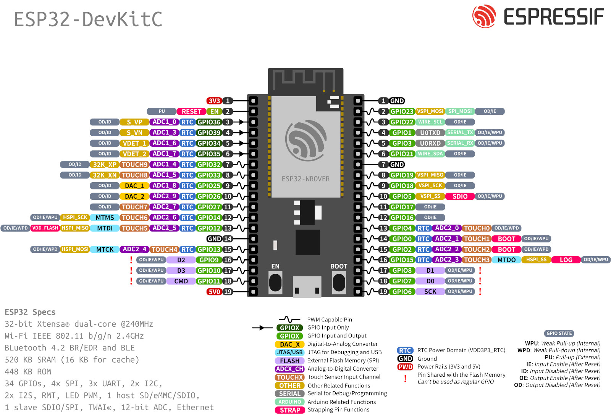
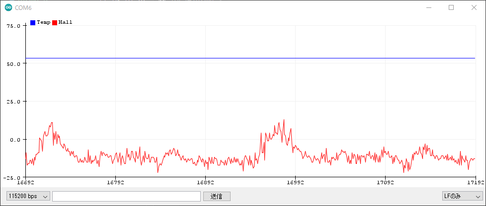
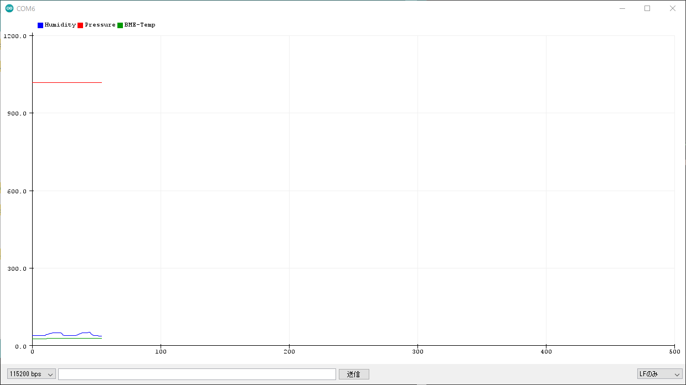

# IoTシステムの構築とその活用


## ESP32-DevKitCについて

> 本演習(2026年度)では，[ESP32-WROVER-E](https://www.espressif.com/sites/default/files/documentation/esp32-wrover-e_esp32-wrover-ie_datasheet_en.pdf)（フラッシュ8MB）を搭載した開発ボード **ESP32-DevKitC-VE** を利用します．

ESP32-DevKitCは，Espressif社のESP32モジュールを搭載した開発用評価ボードです．搭載モジュールの違いで，ESP32-WROOM-32Eを載せた **ESP32-DevKitC-32E** や，ESP32-WROVER-Eを載せた **ESP32-DevKitC-VE** などがあります．

手軽にESP32を利用することができ，モジュールにはWi-FiとBluetoothの通信機能が内蔵されています．開発環境として，Arduino IDEを使う方法，ESP-IDFという専用の開発環境を使用する方法の他に，MicroPythonによる開発が可能です．

### [主な特徴](https://docs.espressif.com/projects/esp-idf/en/latest/esp32/hw-reference/esp32/get-started-devkitc.html)

- IEEE 802.11b/g/nに対応（2.4 GHz）
- Bluetooth Classic及びBLE（4.2）に対応（デュアルモード）
- 低消費電力の32 bit デュアルコアMCUを搭載
- 12 bit SAR A/Dコンバータを搭載
- TCP/IPのプロトコルスタックを搭載
- (H)SPI、UART、I2C、I2S、PWM、GPIOなどさまざまなインターフェースを搭載


### 仕様 (ESP32-WROOM-32E)

以下はESP32-WROOM-32Eの代表的な仕様です．本演習で使うESP32-WROVER-Eは，基本的な仕様は同じで，主に次の点が異なります．

- フラッシュ：4MB / 8MB / 16MB（本演習のボードは8MB）
- PSRAM：8MBを搭載（大きなデータを扱う処理に使える）
- **GPIO16, GPIO17はPSRAMの接続に使われているため，WROVERでは使用できません．** WROOM用の配線例をそのまま使うときは注意してください．


- SoC：ESP32（Tensilica LX6 デュアルコア、240 MHz）
- Wi-Fi：802.11 b/g/n（HT40）
- Bluetooth：Classic、BLE 4.2（デュアルモード）
- Wi-Fiモード：Station/softAP/SoftAP+station/P2P
- セキュリティ：WPA/WPA2/WPA2-エンタープライズ/WPS
- 暗号化：AES/RSA/ECC/SHA
- SRAM：520 KB
- フラッシュ：4 MB
- 動作電圧：2.2～3.6 V
- 消費電流：平均80 mA
- 動作温度：-40℃～+85°C
- オンチップセンサ：ホールセンサ、温度センサ
- インターフェース
  - GPIO
  - I2C
  - UART
  - SPI
  - モータ用PWM
  - LED用PWM
  - I2S
  - ADC
  - DAC
  - SDカード（SDIO）
  - IR
  - 静電容量式タッチセンサ
  - ローノイズプリアンプ


### ピン配置

ピンレイアウトは下図の通りとなる．


<center>
    
</center>


## オンチップ温度の取得

1秒毎に内蔵の温度センサの値を取得してシリアルへ出力を行います．

- 内蔵温度センサ
  - `temperatureRead()`

> 内蔵温度センサはチップ自体の温度を測るもので，室温の測定には向きません．個体差も大きく，値が変化しない（例：常に53.3℃）ボードもあります．ここでは「マイコン内部の値を周期的に読み出してシリアルに出す」流れを確認することが目的です．
>
> 以前の資料で使っていた内蔵ホールセンサの `hallRead()` は，ESP32 Arduinoコア 3.x 系で廃止されました．

> `Ticker` は，指定した時間ごとに関数を呼び出すタイマ機能です．ESP32 Arduinoコアに標準で含まれています．タイマから呼ばれる関数は別のタスクで動くため，**時間のかかる処理（通信など）は書かない**のが原則です．MQTT通信を行う後半のコードでは，`loop()` の中で `millis()` を使って周期処理を行う書き方に切り替えます．


```c

#include <Ticker.h>

// Timer event
Ticker tickerInternal;

void displayInternalSensorData() {
  // シリアルプロッターは「ラベル:値」の形式で1行ずつ受け取ります
  Serial.print("Temp:");
  Serial.println(temperatureRead());
}


void setup() {

  Serial.begin(115200);

  tickerInternal.attach_ms(1000, displayInternalSensorData);

}


void loop() {

}

```


プログラムをコンパイル・転送を行い，シリアルプロッターで起動を確認する．

<center>
    
</center>


## BME280センサデータの取得

BME280センサーをESP32にI2C接続を行いデータを取得する


### ESP32とBME280との接続

|信号名|BME280|ESP32 GPIO|
|:-:|:-:|:-:|
|SCL|SCK|22|
|SDA|SDI|21|
|(アドレス選択)|SDO|(3.3V)|
|(電源/VDD)|Vio|(3.3V)|
|(電源/GND)|GND|(GND)|

> BME280のI2Cアドレスは，SDO端子の接続で決まります．SDOを3.3Vにつなぐと `0x77`，GNDにつなぐと `0x76` です．コード中の `bme.setI2CAddress()` の値と一致していないと，`The sensor did not respond.` と表示されて止まります．

### Arduino  Code


```c

#include <Ticker.h>
#include <Wire.h>
#include <SparkFunBME280.h>

// Timer event
Ticker tickerBME280;

// BME280

BME280 bme;
BME280_SensorMeasurements measurements;


void displayBME280SensorData() {
  bme.readAllMeasurements(&measurements);
  // シリアルプロッター用に「ラベル:値,ラベル:値,...」の形式で出力
  Serial.print("Humidity:");
  Serial.print(measurements.humidity, 0);
  Serial.print(",Pressure:");
  Serial.print(measurements.pressure / 100, 2);
  Serial.print(",BME-Temp:");
  Serial.println(measurements.temperature, 2);
}


void setup() {

  Serial.begin(115200);

  Wire.begin();
  bme.setI2CAddress(0x77);  // I2C address {0x76:GND or 0x77:VDD}
  if (bme.beginI2C() == false) //Begin communication over I2C
  {
    Serial.println("The sensor did not respond. Please check wiring.");
    while (1); //Freeze
  }

  tickerBME280.attach_ms(5000, displayBME280SensorData);

}


void loop() {

}

```

プログラムをコンパイル・転送を行い，シリアルプロッターで起動を確認する．

<center>
    
</center>

