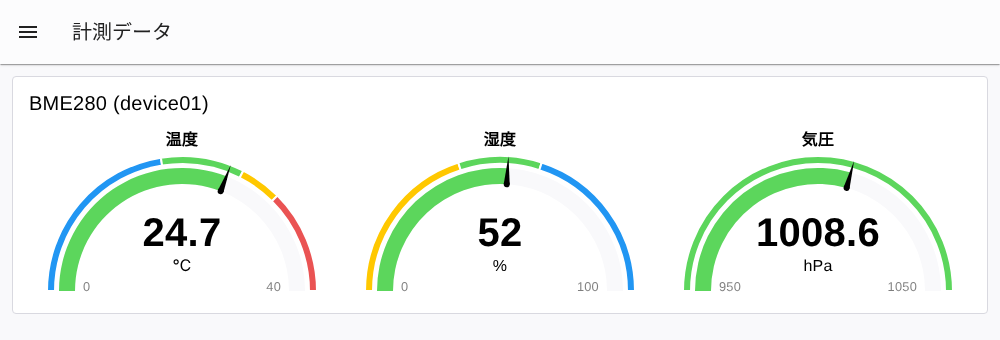
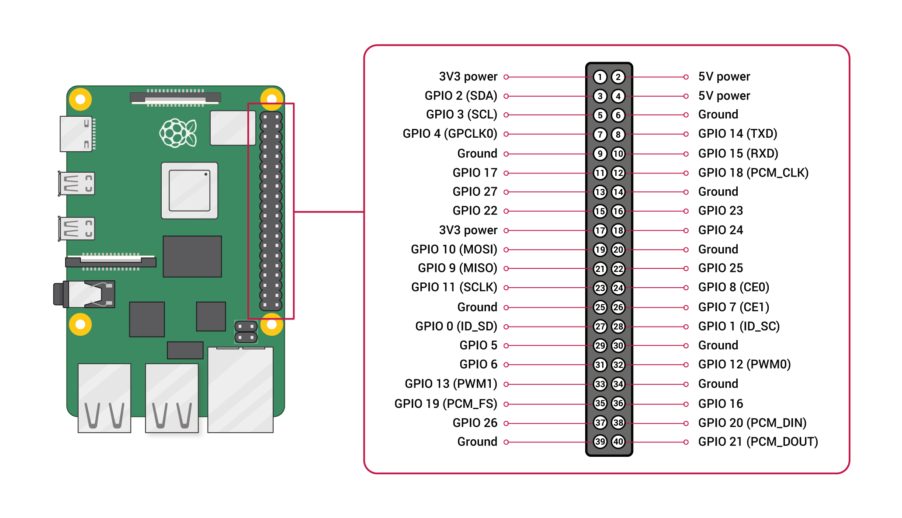
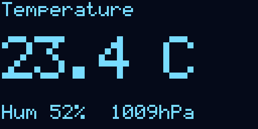

# IoTシステムの構築とその活用

> **完成版のNode-REDフロー：** この演習が終わった時点のフローを [`node-red/s04_dashboard.json`](node-red/s04_dashboard.json) に用意しています．遅れたときや，うまく動かないときに読み込んで使ってください（読み込み方は [node-red/README.md](node-red/README.md)）．

## ESP32をPublisherにして，センサ情報を送信する

以下のコードは，MQTTブローカへBME280センサで取得したデータを送信します．

### コードのポイント

- `client.loop()` はMQTTの送受信や接続維持（ping）を行う関数です．`loop()` の中で**止めずに何度も呼び続ける**必要があります．
- 一定間隔の送信は，`millis()`（起動からの経過ミリ秒）で前回の送信時刻と比べて判断しています．`delay(5000)` のように長く待つと，その間 `client.loop()` が呼ばれず，受信や接続維持が止まってしまうためです．
- s02で使った `Ticker` の関数は別のタスクで動きます．MQTTのライブラリ（PubSubClient）は複数のタスクから同時に使うことを想定していないため，通信処理は `loop()` の中にまとめています．
- 接続に失敗すると `client.state()` の値を表示します．`-2` はブローカに届いていない（IPアドレスの誤り，同じネットワークにいない，など）ことを表します．

```c
#include <WiFi.h>
#include <Wire.h>
#include <time.h>
#include <PubSubClient.h>
#include <ArduinoJson.h>
#include <SparkFunBME280.h>

// wifi config
#define WIFI_SSID "{WiFiSSID}"
#define WIFI_PASSWORD "{WiFiパスワード}"

// MQTT config
#define MQTT_SERVER "{Raspi IPアドレス}"
#define MQTT_PORT 1883
#define MQTT_BUFFER_SIZE 128
#define TOPIC "device01/bme"

// デバイスID　デバイスIDは機器ごとにユニークにします
#define DEVICE_ID "esp001"

// センサデータの送信間隔 (ミリ秒)
#define SEND_INTERVAL_MS 5000

// BME280
BME280 bme;
BME280_SensorMeasurements measurements;

// MQTT Publish用のJSONとバッファ
JsonDocument json_message;
char message_buffer[MQTT_BUFFER_SIZE];

// MQTT用インスタンス作成
WiFiClient espClient;
PubSubClient client(espClient);

// 最後にデータを送信した時刻 (millis()の値)
unsigned long lastSendTime = 0;


// WiFiへの接続
void setupWiFi() {
  WiFi.begin(WIFI_SSID, WIFI_PASSWORD);
  Serial.print("WiFi connecting");
  while (WiFi.status() != WL_CONNECTED) {
    Serial.print(".");
    delay(500);
  }

  Serial.println("");
  Serial.print("Connected : ");
  Serial.println(WiFi.localIP());
  // sync Time
  configTime(3600L * 9, 0, "ntp.nict.jp", "ntp.jst.mfeed.ad.jp");
}


// MQTTブローカへの接続（切断されていたら再接続）
void connectMqtt() {
  while (!client.connected()) {
    Serial.println("Mqtt Reconnecting");
    if (client.connect(DEVICE_ID)) {
      Serial.println("Mqtt Connected");
    } else {
      // 接続に失敗した理由をコードで表示 (例: -2 はブローカに届かない)
      Serial.print("failed, state=");
      Serial.println(client.state());
      delay(1000);
    }
  }
}


void sendSensorData() {
  //センサからデータの取得
  bme.readAllMeasurements(&measurements);
  Serial.println("Humidity,Pressure,BME-Temp");
  Serial.print(measurements.humidity, 0);
  Serial.print(",");
  Serial.print(measurements.pressure / 100, 2);
  Serial.print(",");
  Serial.println(measurements.temperature, 2);

  // ペイロードを作成して送信を行う．
  json_message.clear();
  json_message["humid"] = measurements.humidity;
  json_message["press"] = measurements.pressure / 100;
  json_message["temp"] = measurements.temperature;
  serializeJson(json_message, message_buffer, sizeof(message_buffer));
  client.publish(TOPIC, message_buffer);
}


void setup() {
  Serial.begin(115200);

  Wire.begin();
  bme.setI2CAddress(0x77);  // I2C address {0x76:GND or 0x77:VDD}
  if (bme.beginI2C() == false) //Begin communication over I2C
  {
    Serial.println("The sensor did not respond. Please check wiring.");
    while (1); //Freeze
  }

  // WiFi接続
  setupWiFi();

  // MQTTブローカの設定
  client.setServer(MQTT_SERVER, MQTT_PORT);
}


void loop() {
  // MQTT未接続の場合は，再接続
  if (!client.connected()) {
    connectMqtt();
  }
  // MQTTの送受信処理（loopのたびに必ず呼ぶ）
  client.loop();

  // 前回の送信から SEND_INTERVAL_MS 経過していたら送信する
  unsigned long now = millis();
  if (now - lastSendTime >= SEND_INTERVAL_MS) {
    lastSendTime = now;
    sendSensorData();
  }
}
```


プログラムをコンパイル・転送を行い，シリアルモニターで起動を確認する．


## node-red ダッシュボード機能

ダッシュボード用のノードを追加すると，Node-REDだけで簡単にダッシュボードを作成できます．

> 以前の資料で使っていた `node-red-dashboard`（Dashboard 1.x）は開発が終了し，非推奨になりました．本資料では後継の **`@flowfuse/node-red-dashboard`（Dashboard 2.0）** を使います．

### `@flowfuse/node-red-dashboard` ノードの追加

メニューの `パレットの管理` → `ノードを追加` を選択して，`@flowfuse/node-red-dashboard` を検索し追加を行う．

### ゲージで温度を表示する

1. 前の節で作った `mqtt in` ノード（トピック `device01/bme`）を使います．出力の設定が `自動判定（JSONオブジェクト，文字列もしくはバイナリバッファ）` または `JSONオブジェクト` になっていることを確認します．
2. `change` ノードを追加し，`msg.payload` に `msg.payload.temp` を代入する設定にします．これで温度の値だけが次のノードに渡ります．
3. パレットの `dashboard 2` カテゴリから `gauge` ノードを追加し，`change` ノードとつなぎます．
4. `gauge` ノードを開き，`Group` の鉛筆アイコンから新しいグループを作成します．このとき，グループを置くページ（Page）とダッシュボード本体（UI）も一緒に作成されます．
5. `Range` に表示範囲（例：0〜40），`Label` に `温度` などを設定し，デプロイします．
6. ブラウザで `http://[Raspberry PiのIPアドレス]:1880/dashboard` にアクセスします．

湿度・気圧も，同じように `change` ノードと `gauge` ノード（または `chart` ノード）を追加すると表示できます．

### ダッシュボードの例

次の図は，ESP32 より送信したデータをゲージ表示したものである．

<center>
    
</center>


# Node-REDを用いた　OLEDディスプレイへの表示

Raspberry PiにOLEDディスプレイ（SSD1306，128×64ドット，I2C接続）をつなぎ，ESP32から届いた温度などをNode-REDで表示します．

> **完成版のフロー：** [`node-red/s04_oled_temp.json`](node-red/s04_oled_temp.json)（読み込み方は [node-red/README.md](node-red/README.md)）．この節の手順でI2Cの有効化とノードのインストールを済ませてから読み込んでください．

## OLEDディスプレイのセットアップ

Raspberry Piの電源を切った状態で，OLEDディスプレイをRaspberry Pi に接続します．

 [Raspberry Pi GPIO Pinout](https://github.com/raspberrypi/documentation/blob/develop/documentation/asciidoc/computers/raspberry-pi/gpio-on-raspberry-pi.adoc#gpio-and-the-40-pin-header)

|OLED|Raspberry Pi|
|:-:|:-:|
|SDA|GPIO 2（3番ピン）|
|SCL|GPIO 3（5番ピン）|
|VDD（VCC）|3.3V（1番ピン）|
|GND|GND（6番ピン など）|

## I2Cを有効にする

Raspberry Piは，初期状態ではI2Cが無効になっています．ターミナルで次のコマンドを実行します．

```shell
$ sudo raspi-config
```

`3 Interface Options` → `I2C` → `はい（Yes）` を選び，`Finish` で終了します．

> メニューを使わずに，`sudo raspi-config nonint do_i2c 0` でも有効にできます（最後の `0` が「有効」の意味です）．

## I2Cデバイスの確認

I2Cの状態を調べるツールをインストールします．

```shell
$ sudo apt install -y i2c-tools
```

下記のコマンドを実行し，アドレスを調べます．

```shell
$ sudo i2cdetect -y 1
```

```shell
     0  1  2  3  4  5  6  7  8  9  a  b  c  d  e  f
00:                         -- -- -- -- -- -- -- -- 
10: -- -- -- -- -- -- -- -- -- -- -- -- -- -- -- -- 
20: -- -- -- -- -- -- -- -- -- -- -- -- -- -- -- -- 
30: -- -- -- -- -- -- -- -- -- -- -- -- 3c -- -- -- 
40: -- -- -- -- -- -- -- -- -- -- -- -- -- -- -- -- 
50: -- -- -- -- -- -- -- -- -- -- -- -- -- -- -- -- 
60: -- -- -- -- -- -- -- -- -- -- -- -- -- -- -- -- 
70: -- -- -- -- -- -- -- --  
```

`3c` が表示されていれば，OLEDディスプレイが認識されています．

- 何も表示されない場合は，配線と，I2Cが有効になっているかを確認します．
- `3d` と表示される製品もあります．その場合は，後の設定でアドレスを `61` にします．

## node-red-contrib-oled-i2cのインストール

OLEDディスプレイに表示するためのノードをインストールし，Node-REDを再起動します．

```shell
$ cd ~/.node-red
$ npm install node-red-contrib-oled-i2c
$ cd ~
$ node-red-restart
```

> インストール中にプログラムのビルド（コンパイル）が行われます．エラーになる場合は，[s03](s03.md)で `build-essential` をインストールしたか確認してください．

再起動後，Node-REDのパレットに `oled` というカテゴリが追加されます．

## 温度を表示するフローの作成

ESP32から届いたデータ（`device01/bme`）を受け取り，画面を消してから温度などを書き直すフローを作ります．

```
[mqtt in] → [function] ─(出力1)→ [Clear]   画面を消す
                       └(出力2)→ [String]  文字を書く
```

|ノード|設定|
|:-|:-|
|mqtt in|トピック `device01/bme`，出力 `自動判定`（s03で作ったものと同じ設定）|
|function|名前 `OLEDの表示内容`，`出力数` を **2** にする．コードは下記|
|Clear（oledカテゴリ）|Display に下記のOLEDの設定を選ぶ|
|String（oledカテゴリ）|Display に下記のOLEDの設定を選ぶ|

### OLEDの設定

`Clear` ノードを開き，Display の鉛筆アイコンからOLEDの設定を新しく作ります．`String` ノードでも同じ設定を選びます．

|項目|値|
|:-|:-|
|Address|**60**|
|Width|128|
|Height|64|
|Driver|SSD1306|
|I2C Bus|1|

> **注意：Addressは `0x3c` ではなく `60` と入力します．** `60` は16進数の `0x3c` を10進数で書いたものです．このノードは入力された値を10進数として読むため，`0x3c` と入力すると正しいアドレスにならず，何も表示されません．`i2cdetect` で `3d` と表示された場合は `61` にします．
>
> 1.3インチなど一部のOLEDは，SSD1306ではなく SH1106 というコントローラを使っています．何も表示されない場合や表示が横にずれる場合は，Driver を `SH1106` にしてみてください．

### functionノードのコード

```javascript
// MQTTで受け取ったセンサデータを，OLEDに表示する内容に変換する
//   出力1 → Clear ノード（画面を消す）
//   出力2 → String ノード（文字を書く．3行分を上から順に送る）
const d = msg.payload;
if (typeof d !== "object" || typeof d.temp !== "number") {
    return null;   // 温度が入っていないデータは表示しない
}

// 数値を決まった桁数の文字列にする（値がないときは "--"）
const fmt = (v, digits) => (typeof v === "number" ? v.toFixed(digits) : "--");

// x, y：文字の左上の位置（ドット）  size：文字の拡大率  font：フォント
const lines = [
    { payload: { x: 1, y: 1,  size: 1, font: "oled_5x7", text: "Temperature" } },
    { payload: { x: 1, y: 18, size: 3, font: "oled_5x7", text: fmt(d.temp, 1) + " C" } },
    { payload: { x: 1, y: 52, size: 1, font: "oled_5x7", text: "Hum " + fmt(d.humid, 0) + "%  " + fmt(d.press, 0) + "hPa" } },
];

return [ { payload: true }, lines ];
```

### Stringノードに渡すデータ

`String` ノードには，次の形のデータを1行ずつ送ります．

|キー|意味|
|:-|:-|
|`x`，`y`|文字の左上の位置（ドット）．画面は横128×縦64ドット|
|`size`|文字の拡大率．`oled_5x7` フォントで `size: 3` なら，1文字が横15×縦21ドット|
|`font`|フォント名（`oled_5x7`，`small_6x8`，`retro_8x16` など．一覧は String ノードのヘルプにあります）|
|`text`|表示する文字列（英数字と記号．日本語は表示できません）|

- functionノードの出力2から，3つのメッセージを上から順に送っています．`return [出力1, 出力2]` の形で，出力2に配列を渡すと，複数のメッセージを順番に送れます．
- 書き直す前に `Clear` で画面を消しているのは，前の文字が残らないようにするためです．例えば「23.4」の上に「9.8」を書くと，消さなければ前の数字の一部が残ってしまいます．

## 動作確認

デプロイしてESP32からデータが届くと，次のように表示されます（表示の例）．

<center>
    
</center>

## うまく表示されないとき

- OLEDの設定の Address が `60`（または `61`）になっているか確認します．
- `sudo i2cdetect -y 1` で `3c`（または `3d`）が表示されるか確認します．
- `node-red-log` でNode-REDのログを確認します．
  - `ENOENT` や `/dev/i2c-1` が見つからないというエラー：I2Cが有効になっていません．
  - `Remote I/O error`：配線かアドレスが違います．
- functionノードの下に表示されるエラーや，`debug` ノードで受信データ（`msg.payload.temp`）が届いているか確認します．

### その他のサンプルフロー

- https://github.com/hadifikri/node-red-contrib-oled-i2c/tree/main/examples
