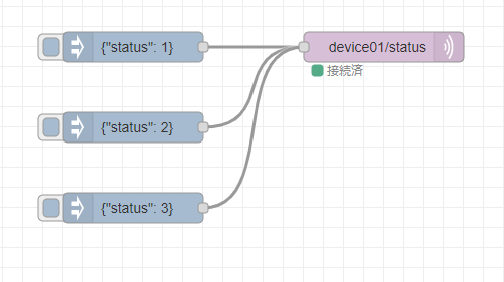

# IoTシステムの構築とその活用

> **完成版のNode-REDフロー：** この演習が終わった時点のフローを [`node-red/s05_led_control.json`](node-red/s05_led_control.json) に用意しています．遅れたときや，うまく動かないときに読み込んで使ってください（読み込み方は [node-red/README.md](node-red/README.md)）．

## MQTT Subscribe

MQTTサーバからの情報を処理する．Subscriberの機能を実装することでサーバーからの要求に応じたデバイスの処理を行うことができます．


## Subscriberへの通知



`mqtt out` ノードを配置して，トピックに `device01/status` と入力します．このノードに `inject` ノードを接続します．`inject` ノードのpayload は`json` として，それぞれに，status: 1 to 3 を入力します．

```json
{"status": 1}
```


# Subscriberの機能追加

トピック  `device01/status` へ 0から3のstatusコードに応じてデバイス(ESP32)に接続したLEDの点灯を制御します．

|status|LEDの動作|
|:-:|:-:|
|0|変更なし|
|1|点灯|
|2|消灯|
|3|点滅|

LEDは抵抗（220Ω〜1kΩ程度）を直列に入れて，GPIO4とGNDの間に接続します．

### コードのポイント

- `client.setCallback(mqttCallback)` で，メッセージを受信したときに呼ばれる関数を登録します．実際に呼ばれるのは `client.loop()` の中です．
- `client.subscribe()` は，**接続（再接続）のたびに**行う必要があります．切断されると購読の情報が消えるためです．
- 点滅も `millis()` を使って切り替えています．`delay()` で点滅させると，その間は受信処理が止まり，次の指示にすぐ反応できません．


## Arduino codeを次のコードを入力します．

```c
#include <WiFi.h>
#include <Wire.h>
#include <time.h>
#include <PubSubClient.h>
#include <ArduinoJson.h>
#include <SparkFunBME280.h>

// wifi config
#define WIFI_SSID "{WiFiSSID}"
#define WIFI_PASSWORD "{WiFiパスワード}"

// MQTT config
#define MQTT_SERVER "{Raspi IPアドレス}"
#define MQTT_PORT 1883
#define MQTT_BUFFER_SIZE 128
#define TOPIC "device01/bme"
#define TOPIC_STATUS "device01/status"

// デバイスID　デバイスIDは機器ごとにユニークにします
#define DEVICE_ID "esp001"

// センサデータの送信間隔 (ミリ秒)
#define SEND_INTERVAL_MS 3000

// LED
#define LED_PIN 4
#define BLINK_INTERVAL_MS 100

// BME280
BME280 bme;
BME280_SensorMeasurements measurements;

// MQTT Subscribe用のJSON
JsonDocument json_request;

// MQTT Publish用のJSONとバッファ
JsonDocument json_message;
char message_buffer[MQTT_BUFFER_SIZE];

// MQTT用インスタンス作成
WiFiClient espClient;
PubSubClient client(espClient);

// 最後にデータを送信した時刻 (millis()の値)
unsigned long lastSendTime = 0;

// LEDステータス (0:変更なし 1:点灯 2:消灯 3:点滅)
int led_status = 0;
bool blink_on = false;
unsigned long lastBlinkTime = 0;


// MQTT Subscribeのコールバック（メッセージを受信したときに呼ばれる）
void mqttCallback(char* topic, byte* payload, unsigned int length) {

  DeserializationError err = deserializeJson(json_request, payload, length);
  if (err) {
    Serial.println("Deserialize error");
    Serial.println(err.c_str());
    return;
  }

  serializeJson(json_request, Serial);
  Serial.println("");

  // "status" が無いときは 0 (変更なし) とする
  led_status = json_request["status"] | 0;
}


// WiFiへの接続
void setupWiFi() {
  WiFi.begin(WIFI_SSID, WIFI_PASSWORD);
  Serial.print("WiFi connecting");
  while (WiFi.status() != WL_CONNECTED) {
    Serial.print(".");
    delay(500);
  }

  Serial.println("");
  Serial.print("Connected : ");
  Serial.println(WiFi.localIP());
  // sync Time
  configTime(3600L * 9, 0, "ntp.nict.jp", "ntp.jst.mfeed.ad.jp");
}


// MQTTブローカへの接続（切断されていたら再接続）
void connectMqtt() {
  while (!client.connected()) {
    Serial.println("Mqtt Reconnecting");
    if (client.connect(DEVICE_ID)) {
      // 接続のたびに購読し直す
      client.subscribe(TOPIC_STATUS);
      Serial.println("Mqtt Connected");
    } else {
      Serial.print("failed, state=");
      Serial.println(client.state());
      delay(1000);
    }
  }
}


void sendSensorData() {
  //センサからデータの取得
  bme.readAllMeasurements(&measurements);
  Serial.println("Humidity,Pressure,BME-Temp");
  Serial.print(measurements.humidity, 0);
  Serial.print(",");
  Serial.print(measurements.pressure / 100, 2);
  Serial.print(",");
  Serial.println(measurements.temperature, 2);

  // ペイロードを作成して送信を行う．
  json_message.clear();
  json_message["humid"] = measurements.humidity;
  json_message["press"] = measurements.pressure / 100;
  json_message["temp"] = measurements.temperature;
  serializeJson(json_message, message_buffer, sizeof(message_buffer));
  client.publish(TOPIC, message_buffer);
}


// led_status に応じてLEDを制御する（delayを使わない）
void updateLed() {
  switch (led_status) {
    case 1:
      // LED ON
      digitalWrite(LED_PIN, HIGH);
      break;
    case 2:
      // LED OFF
      digitalWrite(LED_PIN, LOW);
      break;
    case 3:
      // LED Blink: BLINK_INTERVAL_MS ごとに点灯/消灯を切り替える
      if (millis() - lastBlinkTime >= BLINK_INTERVAL_MS) {
        lastBlinkTime = millis();
        blink_on = !blink_on;
        digitalWrite(LED_PIN, blink_on ? HIGH : LOW);
      }
      break;
    default:
      // 0 またはそれ以外: 何もしない
      break;
  }
}


void setup() {
  Serial.begin(115200);

  Wire.begin();
  bme.setI2CAddress(0x77);  // I2C address {0x76:GND or 0x77:VDD}
  if (bme.beginI2C() == false) //Begin communication over I2C
  {
    Serial.println("The sensor did not respond. Please check wiring.");
    while (1); //Freeze
  }

  pinMode(LED_PIN, OUTPUT);

  // WiFi接続
  setupWiFi();

  // MQTTブローカの設定と，受信時のコールバックの登録
  client.setServer(MQTT_SERVER, MQTT_PORT);
  client.setCallback(mqttCallback);
}


void loop() {
  // MQTT未接続の場合は，再接続
  if (!client.connected()) {
    connectMqtt();
  }
  // MQTTの送受信処理（受信するとここで mqttCallback が呼ばれる）
  client.loop();

  // 前回の送信から SEND_INTERVAL_MS 経過していたら送信する
  unsigned long now = millis();
  if (now - lastSendTime >= SEND_INTERVAL_MS) {
    lastSendTime = now;
    sendSensorData();
  }

  updateLed();
}
```

 
Node-RED のFlowをデプロイします． `inject` ノードをクリックしてESP32のLEDの点灯することを確認します．


# MQTTの機能を試す

講義で説明したMQTTの機能のうち，Retain，Will（Last Will and Testament），QoSを実際に試します．どれもIoTシステムを実際に運用するときに役立つ機能です．

## Retain：最後のメッセージをブローカに残す

MQTTは，送信された時点で購読しているクライアントにしかメッセージを届けません．そのため，ESP32を再起動すると，直前にどんな指示が出ていたかが分かりません．Retainを付けて送信すると，ブローカがそのトピックの最後のメッセージを保持し，あとから購読したクライアントにもすぐ届けます．

### 実験1：Retainなし

1. `inject` ノードで `{"status": 1}` を送り，LEDを点灯させます．
2. ESP32のENボタン（リセット）を押します．
3. 再起動後，LEDは消えたままになります．再起動前の指示は届きません．

### 実験2：Retainあり

1. `mqtt out` ノードを開き，`保持（Retain）` を `true` にしてデプロイします．
2. `inject` ノードで `{"status": 1}` を送ります．
3. ESP32をリセットします．
4. 再接続して `device01/status` を購読した直後に，LEDが点灯します．

> 保持されたメッセージを消すには，同じトピックに空のペイロードをRetain付きで送信します．（ESP32側では `Deserialize error` と表示されますが，問題ありません．）

**考えてみよう：** 温度の計測値と，機器への指示（LEDの状態）では，どちらにRetainを付けるべきでしょうか．

## Will：デバイスの異常な切断を知らせる

ESP32の電源が抜けたり，Wi-Fiが届かなくなったりすると，ESP32は「切断します」と送ることができません．Willは，**接続時にあらかじめ「自分と通信できなくなったら送ってほしいメッセージ」をブローカに預けておく**機能です．ブローカは，一定時間（キープアライブ）応答がないとそのメッセージを代わりに送信します．

### ESP32側の変更

`connectMqtt()` の `client.connect(DEVICE_ID)` を次のように変更します．

```c
#define TOPIC_CONNECTION "device01/connection"

// MQTTブローカへの接続（切断されていたら再接続）
void connectMqtt() {
  while (!client.connected()) {
    Serial.println("Mqtt Reconnecting");
    // 引数: クライアントID, Willのトピック, WillのQoS, WillのRetain, Willのメッセージ
    if (client.connect(DEVICE_ID, TOPIC_CONNECTION, 0, true, "offline")) {
      // 接続できたら「online」をRetain付きで送る
      client.publish(TOPIC_CONNECTION, "online", true);
      client.subscribe(TOPIC_STATUS);
      Serial.println("Mqtt Connected");
    } else {
      Serial.print("failed, state=");
      Serial.println(client.state());
      delay(1000);
    }
  }
}
```

### Node-RED側の確認

1. `mqtt in` ノードを追加し，トピックを `device01/connection` にして，`debug` ノードにつなぎます．
2. デプロイすると，デバッグ欄に `online` と表示されます．
3. ESP32のUSBケーブルを抜きます．
4. 15〜30秒ほど待つと，デバッグ欄に `offline` と表示されます．

> 待ち時間はキープアライブの間隔で決まります．PubSubClientの初期値は15秒で，`client.setKeepAlive(秒)` で変更できます．間隔を短くすると早く気づけますが，通信量と消費電力が増えます．電池で動かす機器では，このバランスを考えて設定します．

Willと `online` の両方にRetainを付けているので，あとからダッシュボードを開いた人にも，現在の接続状態が分かります．

## QoS：配信の確実さを選ぶ

QoSは，メッセージ配信の確実さを指定する仕組みです．

|QoS|意味|向いている用途の例|
|:-:|:-:|:-:|
|0|最高1回（届かないこともある）|頻繁に送る計測値|
|1|少なくとも1回（重複することがある）|機器への指示，警報|
|2|正確に1回|課金・在庫など重複が許されない処理|

> 本演習で使っているPubSubClientは，送信（publish）はQoS 0のみ，購読（subscribe）はQoS 0と1に対応しています．購読をQoS 1にするには `client.subscribe(TOPIC_STATUS, 1);` とします．Node-REDの `mqtt in` / `mqtt out` ノードでは，QoSを0〜2から選べます．

**考えてみよう：** 自分の分野でIoTを使うとしたら，どのデータにどのQoSを使いますか．「届かなかった場合」と「2回届いた場合」に何が起きるかを考えると判断できます．

# MQTTブローカに認証を設定する

ここまでのブローカは，同じネットワークにいれば誰でも接続でき，LEDを操作することもできます．ユーザー名とパスワードを設定して，接続できるクライアントを制限します．

## Node-RED側の設定

1. `Aedes MQTT broker` ノードを開き，`Security` タブでユーザー名とパスワードを設定します．
2. `mqtt in` / `mqtt out` ノードが使っているサーバ設定（`localhost:1883`）を開き，`セキュリティ` タブに同じユーザー名とパスワードを入力します．
3. デプロイします．この時点で，ESP32は接続できなくなります（`state=5`：認証されていない）．

## ESP32側の変更

```c
#define MQTT_USER "{ユーザー名}"
#define MQTT_PASSWORD "{パスワード}"
```

を追加し，`connectMqtt()` の接続処理を次のように変更します．

```c
if (client.connect(DEVICE_ID, MQTT_USER, MQTT_PASSWORD)) {
```

Willも使う場合は，次のようにまとめて指定します．

```c
if (client.connect(DEVICE_ID, MQTT_USER, MQTT_PASSWORD,
                   TOPIC_CONNECTION, 0, true, "offline")) {
```

> **注意：** この設定でも，ユーザー名とパスワードは暗号化されずにネットワークを流れます．実際の運用では，TLSで暗号化した通信（一般にポート8883）を使います．ESP32では `WiFiClient` の代わりに `WiFiClientSecure` を使うとTLS通信ができます．
