# IoTシステムの構築とその活用

> **完成版のNode-REDフロー：** この演習が終わった時点のフローを [`node-red/s06_firebase.json`](node-red/s06_firebase.json) に用意しています．遅れたときや，うまく動かないときに読み込んで使ってください（読み込み方は [node-red/README.md](node-red/README.md)）．

## Cloudサービスのセットアップ

今回の演習では, Firebaseを利用します．


# Firebaseとは

[Firebase](https://firebase.google.com)はGoogle社が提供するモバイルプラットフォームです．iOS、Android、Web等でアプリケーションを構築し、モバイルサービスを提供する際に必要な機能を備えています．主な機能として、リアルタイムデータベース、ユーザー認証、ストレージ、ホスティング、ファンクション、通知等があります．

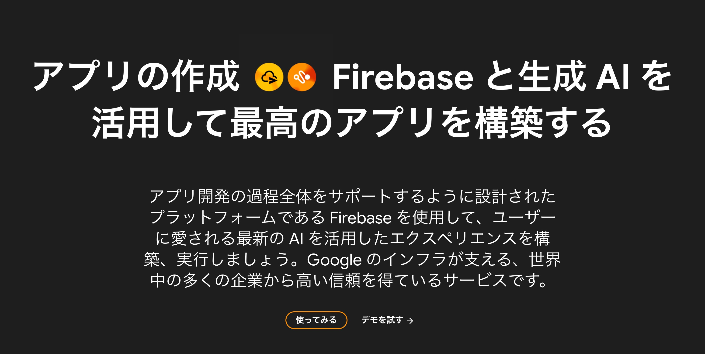

料金プランは，無料のSpark, 従量制のBlazeの2つのプランが存在します．プランに応じて，Realtime Databaseへの同時接続数であったり，Cloud Functionsの呼び出し数やなどに制限があります．各プランの制限事項などの詳細は公式サイトの [料金](https://firebase.google.com/pricing)ページで確認できます．

## Firebaseによるサーバの構築

データベースには、Firebase Realtime Databaseを利用します．また、今後作成するWebアプリケーションの配置先として、Firebase Hostingを利用します．利用するFirebaseの機能概要は以下のとおりです．

### Firebase Realtime Database

Firebase Realtime Databaseはクラウドホスティング型のNoSQLデータベースであり、データとしてJSONデータを保存・同期します．Realtime Database SDKを使うことでリアルタイムに保存・同期を行い、オフラインにも対応します．


### Firebase Hosting

Firebase Hostingは、SPAを簡単に公開できます．CDNやHTTPSにも対応しています．

### Firebase Authentication

Firebase Authenticationは、ユーザー認証システムを簡単に構築できます．ログインプロバイダとして、メールアドレス、電話認証、Google、Twitter、Facebook、GitHubおよび匿名があります．


# 開発環境の準備

Firebaseを用いたサーバ構築に必要な開発環境を準備します．作成するWebサーバは、FirebaseのRealtime DatabaseとHosting機能を利用します．そのための設定を行っていきます．

## Firebaseの利用開始

Firebaseを利用開始するためには、コンソールページへログインします．
ブラウザで `https://console.firebase.google.com` と入力し、Googleアカウントでログインします．

もしくは，Firebaseの[公式サイト](https://firebase.google.com)からログインします．画面の右上の「Go to console」リンクをクリックします．


## Firebaseプロジェクトの作成

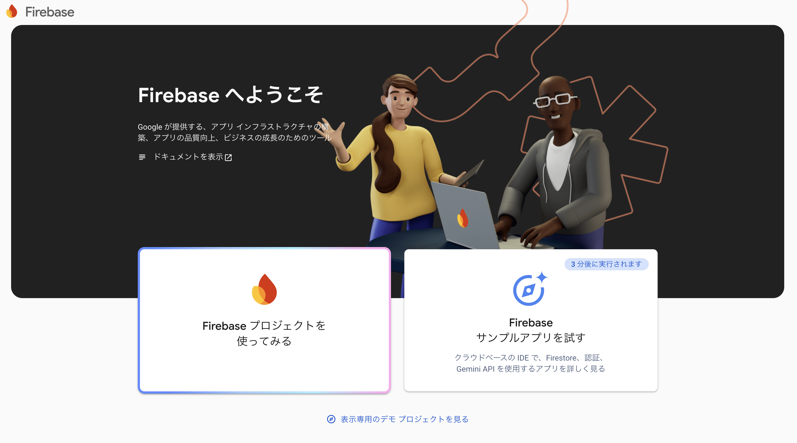

新規にプロジェクトを作成します．コンソールページの中央にある、"プロジェクトを追加"リンクをクリックします．プロジェクトを追加するポップアップ画面が表示されるので、プロジェクト名、プロジェクトID、規約の同意を入力・選択していきます．

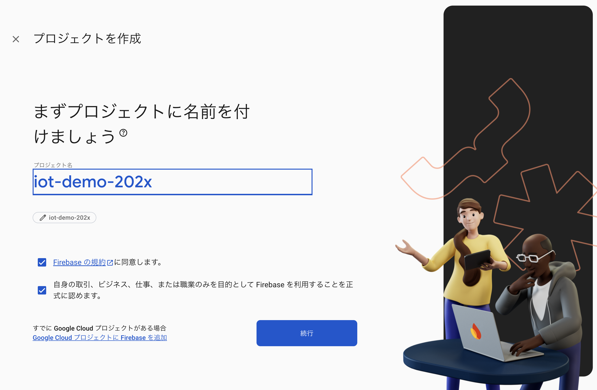

- プロジェクト名は、半角・英数・一部記号で4文字以上を入力します．
- プロジェクトIDを確認します．プロジェクトIDは、先ほど指定したプロジェクト名をベースに自動生成されます．なお、自動生成されたプロジェクトIDを変更したい場合は、鉛筆のアイコンをクリックすることで変更できます．このIDは、Realtime DatabaseやFirebase Hosting等のURLの一部となり、グローバルで一意である必要があります．画面上のヘルプ欄にもありますが、プロジェクトIDは後から変更できませんので注意が必要です．

- "続行"　をクリックします．

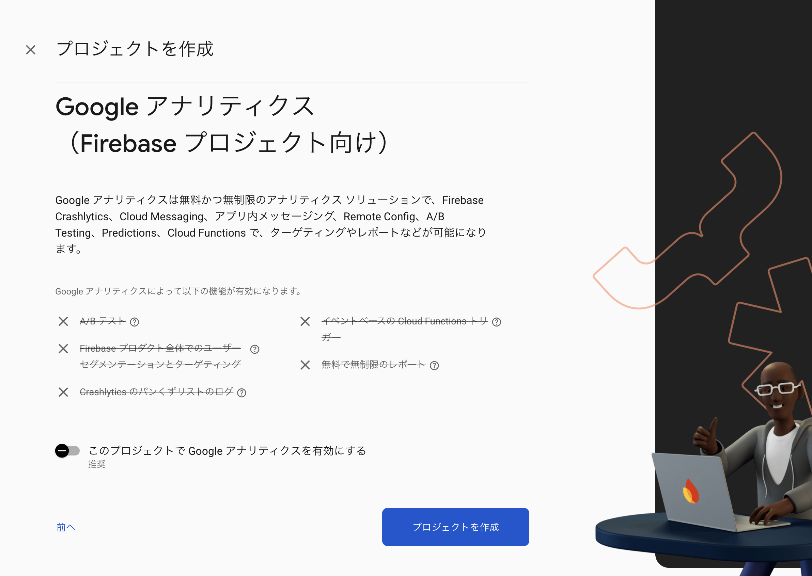

Google Analyticsの設定を行います．今回は、Google Analyticsを利用しないので、"Google Analyticsを設定しない" を選択します．

- "プロジェクトを作成" をクリックします．


## リアルタイムデータベースの作成

ブラウザのFirebase console上で，Realtime Databaseの項目をオープン，リアルタイムデータベースを作成します．

 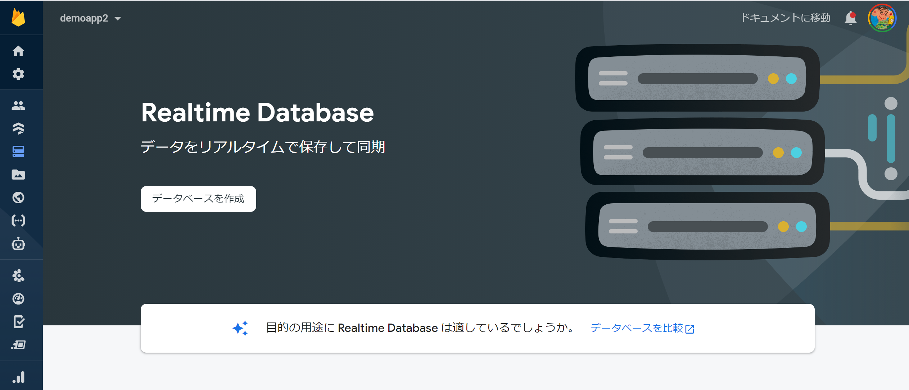

`データベースを作成` ボタンをクリック

### データベースを作成するロケーションを選択

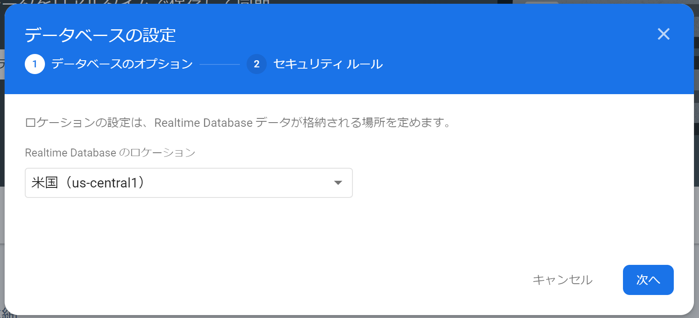

`米国` を選択します．


### セキュリティルールの設定

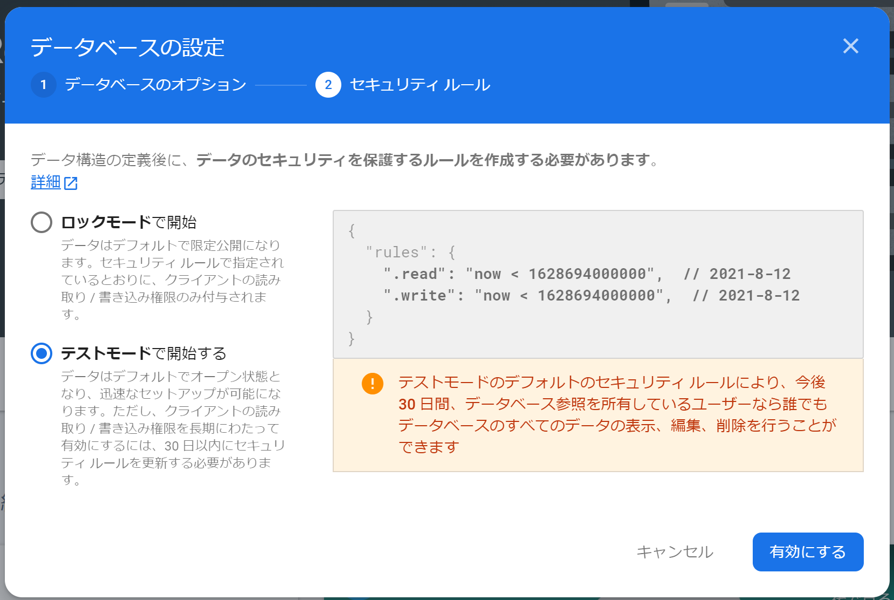

今回は，`テストモード` を選択して実行します．

> テストモードでは，**約30日間，誰でも**データを読み書きできます．期限を過ぎると，今度は誰も読み書きできなくなります．演習を手早く進めるための設定なので，後の節（[s09 データベースのセキュリティルール](s09.md)）で，適切なルールに変更します．

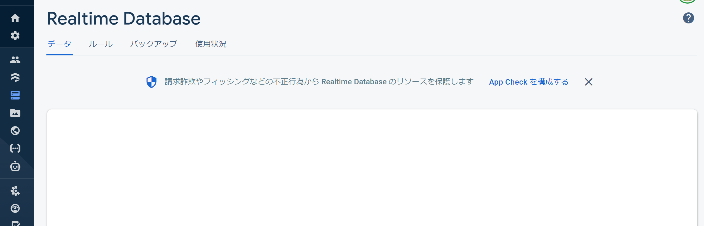


## Firebase CLIのインストール

Firebaseは、CLI(Command Line Interface)により、Firebaseプロジェクトの管理、操作、デプロイ(公開)を行います．


### Windows

Windowsは，以下のアドレスから，スタンドアロンバイナリをダウンロードして実行します

- https://firebase.tools/bin/win/instant/latest

ダウンロードした，バイナリを実行すると， `firebase` コマンドが実行可能なシェルがオープンします．

### macOS, Linux

macOS, Linuxでは，npmコマンドにより firebase-toolsをインストールします．

```bash
npm install -g firebase-tools
```

インストール後、ターミナルから `firebase` コマンドが利用可能になります．

## Firebase CLIでログイン

サーバ構築にあたり、先ほど作成したFirebaseプロジェクトを利用するためにターミナルを使ってFirebaseへログインします． `firebase` コマンドに続き `login`　と入力します．

```bash
firebase login
```

コマンドを入力するとブラウザが立ち上がり、Googleアカウント認証のページが表示されます．認証後、Firebase CLIのアクセスを許可します．

```bash
✔  Success! Logged in as xxx@gmail.com
```

なお、`firebase logout` コマンドを入力するとFirebase CLIはログアウトします．

## Firebaseプロジェクトの初期化

コンソールで作成したプロジェクトに対して、Hostingの機能を利用できるようにしていきます．

ターミナルでプロジェクト用のディレクトリを作成します．今回は，`iot_host`名でディレクトリを作成する．このディレクトリ内がFirebaseプロジェクトのディレクトリとなります．

```bash
mkdir iot_host
cd iot_host
```

### Hostingの設定

Firebase Hostingの設定を行います．ターミナルで `firebase init hosting` コマンドを入力します．ターミナルには、Firebaseプロジェクトが一覧に表示されるので、該当するプロジェクトを選択します．設定が終わると以下のようなディレクトリ構成になります．

```bash
.
├── firebase.json
└── public
    ├── 404.html
    └── index.html
```


# Webサイトの作成

Realtime Databaseに保存されたデータをグラフ化するWebサイトをFirebase Hostingを使い作成をしていきます．

Realtime Database 内に，以下のように保存された，データを可視化していきます．


```bash
.
└── stations
    └── [station_id]
        ├── status
        |   └── status   (LEDの状態 0〜3)
        └── data
            ├── -MZMUBJ_9MfN1vEOZG-V
            ├── -MZMUBJ_9MfN1vEOZG-C
            |   ├── humid
            |   ├── press
            |   └── temp
            └── -MZMUC-11Nq_J6FYCYUK
```


前節でセットアップしたpublicディレクトリ内のファイル `index.html` を編集します．

`public` ディレクトリに移動します．

```bash
cd public
```

## style.css を追加する

エクスプローラ(Windows)やファインダー(macOS)でプロジェクトディレクトリ`iot_host` をオープンし `public` フォルダへ移動します．

ページの見た目（色，レイアウト，スマートフォン対応）は，`style.css` というファイルにまとめています．資料の [`web/public/style.css`](web/public/style.css) を `public` フォルダにコピーします．s07，s08でも同じファイルを使います．

<details>
<summary>style.css の内容（クリックで開く）</summary>

```css
/* IoT 計測ダッシュボード 共通スタイル */

:root {
  --primary: #4e67c8;
  --primary-dark: #3c52a8;
  --navy: #212745;
  --text: #2b3050;
  --muted: #6b7190;
  --bg: #f4f6fb;
  --card: #ffffff;
  --line: #e3e6f0;
  --temp: #e4572e;
  --humid: #2d9cdb;
  --press: #4e67c8;
  --ok: #2fa36b;
  --error: #c62828;
  --radius: 14px;
}

* {
  box-sizing: border-box;
}

body {
  margin: 0;
  background: var(--bg);
  color: var(--text);
  font-family: system-ui, -apple-system, "Hiragino Sans", "Noto Sans JP", "Yu Gothic UI", sans-serif;
  line-height: 1.6;
}

/* ---------- ヘッダー ---------- */
.app-header {
  background: var(--navy);
  color: #fff;
}

.app-header .inner {
  max-width: 1100px;
  margin: 0 auto;
  padding: 14px 20px;
  display: flex;
  align-items: center;
  justify-content: space-between;
  gap: 12px;
  flex-wrap: wrap;
}

.app-header h1 {
  margin: 0;
  font-size: 1.25rem;
  font-weight: 700;
  letter-spacing: 0.02em;
}

.app-header .station {
  font-size: 0.85rem;
  opacity: 0.75;
  margin-left: 10px;
  font-weight: 400;
}

.user {
  display: flex;
  align-items: center;
  gap: 12px;
  font-size: 0.9rem;
}

/* ---------- レイアウト ---------- */
main {
  max-width: 1100px;
  margin: 0 auto;
  padding: 24px 20px 40px;
}

.card {
  background: var(--card);
  border-radius: var(--radius);
  box-shadow: 0 1px 3px rgba(33, 39, 69, 0.08);
  padding: 20px 22px;
  margin-bottom: 20px;
}

.card h2 {
  margin: 0 0 12px;
  font-size: 1.05rem;
}

.card-head {
  display: flex;
  align-items: baseline;
  justify-content: space-between;
  gap: 12px;
  flex-wrap: wrap;
}

.note {
  color: var(--muted);
  font-size: 0.85rem;
}

/* ---------- 現在値のタイル ---------- */
.tiles {
  display: grid;
  grid-template-columns: repeat(3, 1fr);
  gap: 16px;
  margin-bottom: 20px;
}

.tile {
  background: var(--card);
  border-radius: var(--radius);
  box-shadow: 0 1px 3px rgba(33, 39, 69, 0.08);
  padding: 16px 20px;
}

.tile .label {
  font-size: 0.9rem;
  color: var(--muted);
  display: flex;
  align-items: center;
  gap: 8px;
}

.tile .label::before {
  content: "";
  width: 10px;
  height: 10px;
  border-radius: 50%;
  background: var(--accent);
}

.tile .value {
  font-size: 2.4rem;
  font-weight: 700;
  line-height: 1.2;
  margin-top: 4px;
  font-variant-numeric: tabular-nums;
}

.tile .unit {
  font-size: 1rem;
  font-weight: 400;
  color: var(--muted);
  margin-left: 4px;
}

.tile.temp { --accent: var(--temp); }
.tile.humid { --accent: var(--humid); }
.tile.press { --accent: var(--press); }

/* ---------- グラフ ---------- */
.chart-box {
  position: relative;
  height: 360px;
}

/* ---------- ボタン ---------- */
button {
  font: inherit;
  cursor: pointer;
}

.btn {
  border: 1px solid var(--line);
  background: #fff;
  color: var(--text);
  border-radius: 10px;
  padding: 8px 18px;
  transition: background 0.15s, border-color 0.15s;
}

.btn:hover {
  border-color: var(--primary);
}

.btn-primary {
  background: var(--primary);
  border-color: var(--primary);
  color: #fff;
}

.btn-primary:hover {
  background: var(--primary-dark);
}

.app-header .btn {
  background: transparent;
  border-color: rgba(255, 255, 255, 0.4);
  color: #fff;
  padding: 4px 14px;
}

.app-header .btn:hover {
  border-color: #fff;
}

/* ---------- LEDの操作 ---------- */
.led-row {
  display: flex;
  align-items: center;
  justify-content: space-between;
  gap: 16px;
  flex-wrap: wrap;
}

.segmented {
  display: inline-flex;
  border: 1px solid var(--line);
  border-radius: 12px;
  overflow: hidden;
}

.segmented button {
  border: none;
  background: #fff;
  padding: 10px 26px;
  border-right: 1px solid var(--line);
  color: var(--text);
}

.segmented button:last-child {
  border-right: none;
}

.segmented button:hover {
  background: #eef1fb;
}

.segmented button.active {
  background: var(--primary);
  color: #fff;
}

.led-state {
  display: flex;
  align-items: center;
  gap: 10px;
  color: var(--muted);
}

.lamp {
  width: 18px;
  height: 18px;
  border-radius: 50%;
  background: #c9cdd9;
}

.lamp.on {
  background: #ffcc33;
  box-shadow: 0 0 10px #ffcc33;
}

.lamp.blink {
  background: #ffcc33;
  animation: blink 0.4s steps(1) infinite;
}

@keyframes blink {
  50% { background: #c9cdd9; box-shadow: none; }
}

/* ---------- メッセージ ---------- */
.message {
  color: var(--error);
  font-size: 0.9rem;
  margin: 8px 0 0;
}

.message:empty {
  display: none;
}

/* ---------- ログイン画面 ---------- */
.login-view {
  min-height: calc(100vh - 60px);
  display: flex;
  align-items: center;
  justify-content: center;
  padding: 24px;
}

.login-card {
  width: 100%;
  max-width: 400px;
  text-align: center;
  padding: 36px 32px;
}

.login-card .icon {
  width: 56px;
  height: 56px;
  margin: 0 auto 12px;
  border-radius: 16px;
  background: #eef1fb;
  color: var(--primary);
  display: flex;
  align-items: center;
  justify-content: center;
}

.login-card h2 {
  font-size: 1.3rem;
  margin: 0 0 6px;
}

.login-card p {
  color: var(--muted);
  margin: 0 0 24px;
  font-size: 0.95rem;
}

.btn-login {
  width: 100%;
  padding: 12px 18px;
  font-weight: 700;
}

.btn-login:disabled {
  opacity: 0.6;
  cursor: wait;
}

.domain-notice {
  margin-top: 18px;
  padding: 10px 12px;
  border-radius: 10px;
  background: #fff4e5;
  color: #8a4b00;
  font-size: 0.85rem;
  text-align: left;
}

.domain-notice a {
  color: inherit;
  font-weight: 700;
  word-break: break-all;
}

[hidden] {
  display: none !important;
}

/* ---------- スマートフォン ---------- */
@media (max-width: 640px) {
  .tiles {
    grid-template-columns: 1fr;
    gap: 10px;
  }

  .tile {
    display: flex;
    align-items: baseline;
    justify-content: space-between;
  }

  .tile .value {
    font-size: 1.8rem;
  }

  .chart-box {
    height: 280px;
  }

  .segmented {
    width: 100%;
  }

  .segmented button {
    flex: 1;
    padding: 10px 0;
  }
}
```

</details>

## index.htmlを下記のように修正する

`public` フォルダ内の `index.html` の内容を以下の通りに修正します．（資料として `web/public/index_01.html` が該当します．）

```html
<!DOCTYPE html>
<html lang="ja">
<head>
  <meta charset="utf-8">
  <meta name="viewport" content="width=device-width, initial-scale=1">
  <title>IoT 計測ダッシュボード</title>
  <link rel="stylesheet" href="style.css">
  <!-- Chart.js（グラフ表示ライブラリ） -->
  <script src="https://cdn.jsdelivr.net/npm/chart.js@4.6.1/dist/chart.umd.min.js"></script>
</head>
<body>

  <header class="app-header">
    <div class="inner">
      <h1>IoT 計測ダッシュボード<span class="station">st001</span></h1>
    </div>
  </header>

  <main>
    <section class="tiles">
      <div class="tile temp">
        <div class="label">温度</div>
        <div class="value"><span id="v-temp">--</span><span class="unit">℃</span></div>
      </div>
      <div class="tile humid">
        <div class="label">湿度</div>
        <div class="value"><span id="v-humid">--</span><span class="unit">%</span></div>
      </div>
      <div class="tile press">
        <div class="label">気圧</div>
        <div class="value"><span id="v-press">--</span><span class="unit">hPa</span></div>
      </div>
    </section>

    <section class="card">
      <div class="card-head">
        <h2>計測データの推移</h2>
        <span class="note" id="updated">データを待っています…</span>
      </div>
      <div class="chart-box"><canvas id="chart"></canvas></div>
    </section>


  </main>

  <script type="module">
    // Firebase SDK（modular版）をCDNから読み込む
    import { initializeApp } from "https://www.gstatic.com/firebasejs/13.3.0/firebase-app.js";
    import { getDatabase, ref, query, limitToLast, onChildAdded } from "https://www.gstatic.com/firebasejs/13.3.0/firebase-database.js";

    const station_id = "st001";
    const MAX_POINTS = 100;   // グラフに表示する最大の件数

    // Firebase Hostingが提供するプロジェクトの設定を読み込んで初期化する
    const response = await fetch("/__/firebase/init.json");
    const firebaseConfig = await response.json();
    const app = initializeApp(firebaseConfig);
    const db = getDatabase(app);

    // ---------- グラフ ----------

    const chart = new Chart(document.getElementById("chart"), {
      type: "line",
      data: {
        labels: [],
        datasets: [
          { label: "温度 (℃)", data: [], borderColor: "#e4572e", backgroundColor: "#e4572e", yAxisID: "y" },
          { label: "湿度 (%)", data: [], borderColor: "#2d9cdb", backgroundColor: "#2d9cdb", yAxisID: "y" },
          { label: "気圧 (hPa)", data: [], borderColor: "#4e67c8", backgroundColor: "#4e67c8", yAxisID: "y1" },
        ],
      },
      options: {
        animation: false,
        maintainAspectRatio: false,
        interaction: { mode: "index", intersect: false },
        elements: { point: { radius: 0, hoverRadius: 4 }, line: { borderWidth: 2, tension: 0.25 } },
        plugins: { legend: { position: "top", align: "end", labels: { usePointStyle: true, boxWidth: 8, boxHeight: 8 } } },
        scales: {
          x: { ticks: { maxTicksLimit: 6, maxRotation: 0, autoSkipPadding: 16 }, grid: { display: false } },
          y: { position: "left", title: { display: true, text: "温度・湿度" } },
          y1: { position: "right", title: { display: true, text: "気圧 (hPa)" }, grid: { drawOnChartArea: false } },
        },
      },
    });

    // 1件のデータをグラフに追加する（古いデータは MAX_POINTS 件を超えたら捨てる）
    function addPoint(d) {
      chart.data.labels.push(new Date(d.timestamp).toLocaleTimeString("ja-JP"));
      chart.data.datasets[0].data.push(d.temp);
      chart.data.datasets[1].data.push(d.humid);
      chart.data.datasets[2].data.push(d.press);
      if (chart.data.labels.length > MAX_POINTS) {
        chart.data.labels.shift();
        chart.data.datasets.forEach((ds) => ds.data.shift());
      }
      refreshChart();
    }

    // 最初に100件がまとめて届くので，描き直しは画面の更新1回分にまとめる
    let refreshPending = false;
    function refreshChart() {
      if (refreshPending) return;
      refreshPending = true;
      requestAnimationFrame(() => {
        refreshPending = false;
        chart.update();
      });
    }

    // ---------- 現在値 ----------

    function format(value, digits) {
      return typeof value === "number" ? value.toFixed(digits) : "--";
    }

    function showLatest(d) {
      document.getElementById("v-temp").textContent = format(d.temp, 1);
      document.getElementById("v-humid").textContent = format(d.humid, 0);
      document.getElementById("v-press").textContent = format(d.press, 1);
      document.getElementById("updated").textContent = "最終更新 " + new Date(d.timestamp).toLocaleString("ja-JP");
    }


    // ---------- データの監視 ----------

    // 計測データ：最新100件を読み込み，その後は追加されるたびに呼ばれる
    const dataQuery = query(ref(db, "stations/" + station_id + "/data"), limitToLast(MAX_POINTS));
    onChildAdded(dataQuery, (snapshot) => {
      const d = snapshot.val();
      addPoint(d);
      showLatest(d);
    });
  </script>

</body>
</html>
```

### 画面の構成

ページは，上から順に次の3つの部分でできています．

- **現在値のタイル**：温度・湿度・気圧の最新の値を大きく表示します．
- **計測データの推移**：最新100件をグラフで表示します．グラフには [Chart.js](https://www.chartjs.org/) を使っています．
- **最終更新**：最後にデータが届いた時刻です．値が更新されないときは，ESP32やNode-REDが止まっていないか確認する目安になります．

スマートフォンで開くと，タイルが縦に並ぶレイアウトに自動で切り替わります（`style.css` の `@media` の部分）．

### コードのポイント

このページは，Firebase JavaScript SDKの **modular版**（バージョン9以降の書き方）を使っています．

- `<script type="module">` の中で，必要な機能だけを `import` して使います．
  ```javascript
  import { initializeApp } from "https://www.gstatic.com/firebasejs/13.3.0/firebase-app.js";
  import { getDatabase, ref, query, limitToLast, onChildAdded } from "https://www.gstatic.com/firebasejs/13.3.0/firebase-database.js";
  ```
  URLの `13.3.0` はSDKのバージョンです．最新のバージョンは [Firebase JavaScript SDK リリースノート](https://firebase.google.com/support/release-notes/js) で確認できます．
- プロジェクトの設定（APIキーやデータベースのURLなど）は，Firebase Hostingが自動で用意する `/__/firebase/init.json` から読み込んでいます．Firebaseコンソールから設定をコピーして貼り付ける必要はありません．
  ```javascript
  const response = await fetch("/__/firebase/init.json");
  const firebaseConfig = await response.json();
  const app = initializeApp(firebaseConfig);
  ```
  > `/__/firebase/init.json` はFirebase Hostingで公開したとき（または `firebase emulators:start` で動かしたとき）だけ使えます．HTMLファイルをダブルクリックして開いても動きません．
- データの読み出しは，`ref()` で場所（パス）を指定し，`query()` と `limitToLast(MAX_POINTS)` で最新100件に絞り込んでから，`onChildAdded()` で監視します．データが追加されるたびに，コールバック関数が呼ばれて，グラフへの追加（`addPoint()`）と現在値の表示（`showLatest()`）が行われます．
  ```javascript
  const dataQuery = query(ref(db, "stations/" + station_id + "/data"), limitToLast(MAX_POINTS));
  onChildAdded(dataQuery, (snapshot) => {
    const d = snapshot.val();
    addPoint(d);
    showLatest(d);
  });
  ```
- ページを開いた直後は，既存の100件について続けて `onChildAdded()` が呼ばれます．そのたびにグラフを描き直すと重くなるので，`refreshChart()` で描き直しを画面の更新1回分にまとめています．

> 以前の資料では，`firebase.database().ref(...)` のように書く **compat版**（バージョン8までの書き方）を使っていました．compat版は移行用の互換レイヤーです．新しく作るときはmodular版を使います．

### Webアプリケーションの公開

作成したページを公開します．


プロジェクトのルート(iot_host)に移動して，


ターミナルを使い以下のコマンドを入力します．

```bash
cd ..
firebase deploy
```

しばらく待ちます．デプロイが完了すると、ターミナル上に`Deploy complete!`のメッセージとともに、アドレスが表示されます．

```bash

=== Deploying to '{プロジェクトID}'...

...中略...

+ Deploy complete!

Project Console: https://console.firebase.google.com/project/xxxxx/overview
Hosting URL: https://xxxxx.web.app

```

`Hosting URL` のアドレスをブラウザに入力し表示確認をします．

> Firebase Hostingで公開したページは，`https://[プロジェクトID].web.app` と `https://[プロジェクトID].firebaseapp.com` の2つのアドレスで開けます．どちらも同じページです．s08でログイン機能を追加した後は，`firebaseapp.com` の方を使います（理由はs08で説明します）．


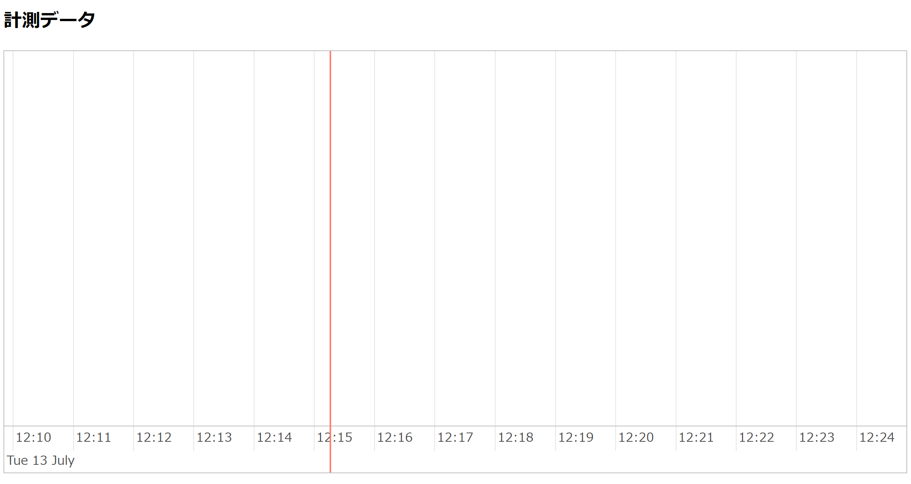


# Node-RED からWebアプリケーションへのデータ送信

Node-REDを用いて，作成したFirebase上のWebアプリケーションへデータを送信します．

## node-redへノードのインストール

Node-REDがFirebaseと通信が可能となるように，ノードを追加します．

node-REDを起動し，`パレットの管理 > ノードの追加`  を開き， `node-red-contrib-firebase-data` ノードを追加します．

## node-redの再起動

ターミナルで，`node-red-stop` を停止させ，`node-red-start` で起動します．

- 停止する

```shell
$ node-red-stop
```

- 起動する

```shell
$ node-red-start
```


## Realtime Databaseへのデータ送信

### `Add Firebase` ノードの追加

パレットから，`Add Firebase` ノードを追加し，ノードの設定を行います．

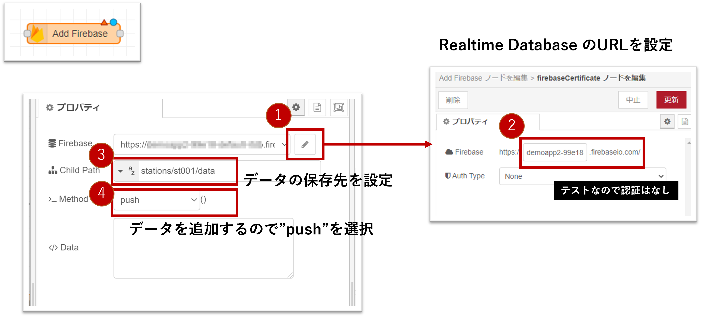

1. Realtime Databaseへ接続するための認証設定を追加します．鉛筆アイコンをクリックして，FirebaseCertificateダイアログを表示します．
2. 自身のRealtime DatabaseのURLを入力します．今回，RealtimeDatabaseはテストモードとして設定してあるので，`Auth type` は`None` を選択してください．
3. デバイスから送信されてきたデータの保存パスを設定します．
4.  `Method` は，新規追加なので，`push` を選択します．

### MQTTノードとの接続

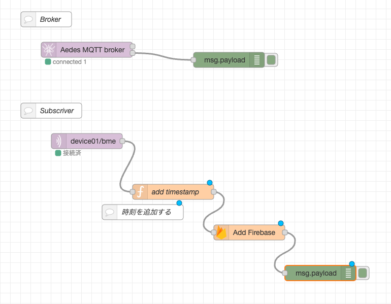

MQTTノードと接続していきます．ESP32デバイスからMQTTプロトコルで送信されてくるデータには，時刻情報がないため，Node-Red上で時刻を追加していきます．

`Function` ノードを間に挟みます．ノード内の`コード`欄に次のプログラムを記述します．

```javascript
msg.payload.timestamp = Date.now();
return msg;
```

Node-Redの右上の `デプロイ` ボタンを押して反映させます．

## データの確認

### Realtime Databaseコンソールで確認

WebのFirebaseコンソールでプロジェクトへアクセスし，Realtime databaseの画面を表示します．

データが送信されていれば，コンソール上でリアルタイムにデータが追加されてるのが確認できます．

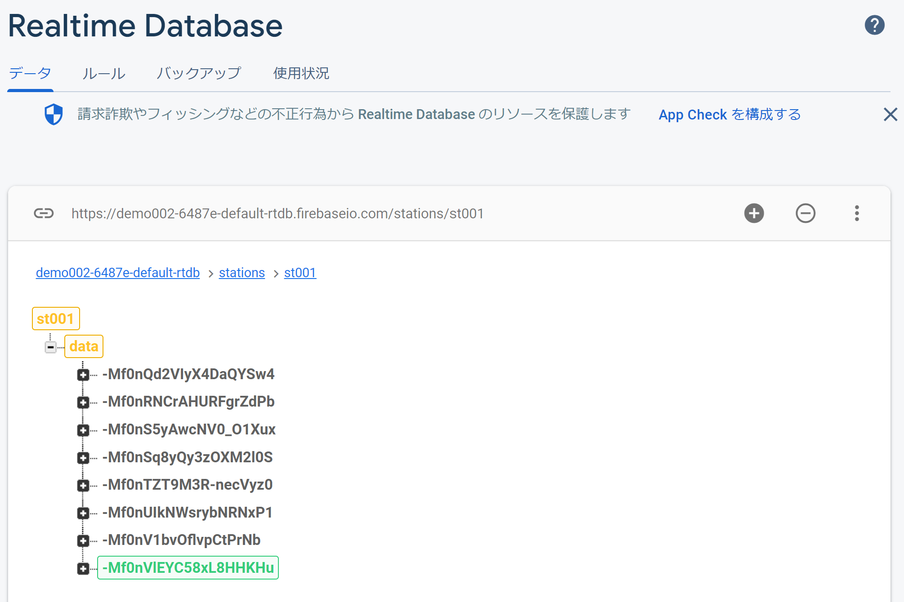


### Firebase HostingのWebアプリで確認

Webアプリケーションでも確認します．WebのFirebaseコンソールでプロジェクト内のHostingの画面を表示します．画面の `[プロジェクトID]のドメイン`項目には，Webアプリがホスティングされているドメインのリストがあります．リスト内のURLをオープンします．

上段に温度・湿度・気圧の現在値が，その下に3つのデータの推移がグラフで表示されているのが確認できます．

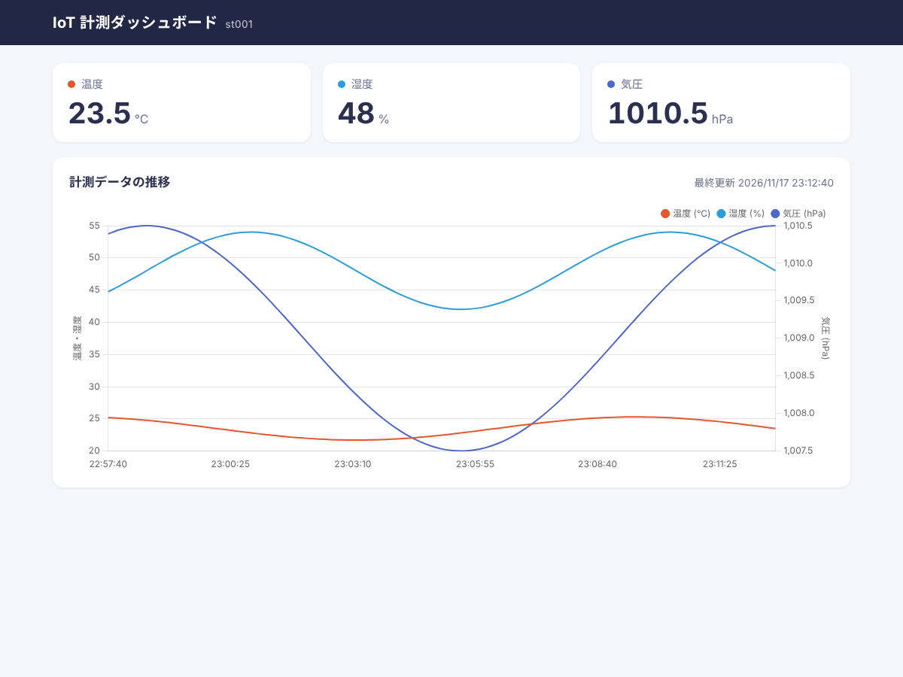


# リファレンス

- Firebase Documents
  - https://firebase.google.com/docs/
  - [ウェブでのデータの読み取りと書き込み](https://firebase.google.com/docs/database/web/read-and-write?hl=ja)
  - [データのリストの操作（onChildAddedなど）](https://firebase.google.com/docs/database/web/lists-of-data?hl=ja)
- Chart.js
  - https://www.chartjs.org/docs/latest/
  - Realtime Database REST
    - [データの取得](https://firebase.google.com/docs/database/rest/retrieve-data?hl=ja)
    - [データの保存](https://firebase.google.com/docs/database/rest/save-data?hl=ja)