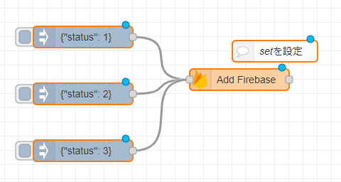

# IoTシステムの構築とその活用

> **完成版のNode-REDフロー：** この演習が終わった時点のフローを [`node-red/s07_firebase_led.json`](node-red/s07_firebase_led.json) に用意しています．遅れたときや，うまく動かないときに読み込んで使ってください（読み込み方は [node-red/README.md](node-red/README.md)）．


# Firebaseとの連携

前回は，MQTT Subscriber を利用して，ESP32のLEDの状態を変更することができました．では，FirebaseのRealtime databaseと連携してESP32のLEDの状態を変更していきます．


## `Realtime database`へLEDの状態を保存する．

BME280データと同様に，`Add Firebase`を利用していきます．

BME280データの保存先は，`stations/st001/data`でした．LEDの状態の保存先は， `stations/st001/status` とします． BME280の時は，新規にデータを追加していたので，`push`メソッドを使っていましたが，今回は，そのパス上のデータ更新ですので，`set`メソッドを使います．

これまでに作成したフローを活用していきます．
MQTT Subscribe用に作成したフローの `inject`ノードと `mqtt out` を切り離します．
 `Add Firebase` ノードを追加し，切り離した`inject`ノードと接続します．



 
 追加した`Add Firebase`の設定を開き，
 - `Firebase`項目は，前回設定した，firebase Realtimeの設定を選択します．
 - `Child Path` は，`stations/st001/status`を入力します．このパスに，デバイスのLEDのカラー状態を設定します．
 - `_Method`は，`set`を選択します．
 


それぞれの `inject` ノードを操作することで，Realtime Database内の状態を変更することができます．


図は，Node-RED内の 2つめの`inject`ノードを操作したさいに，Realtime Database内のデータが更新されている様子です．


## `Realtime database`内のデータを取得して，MQTTで通知する

Realtime Database内のパス`stations/st001/status` のデータを取得して，MQTTでサブスクライバーへ通知していきます．
取得でも，`Add Firebase`ノードを利用します．しかし，このノードは，Realtime Databaseの変更監視(`.on`イベント)をすることはできません．`inject`ノードの定期実行機能を利用していきます．

新たに，`Add Firebase` ノードを追加します．図の様に，ノードを配置接続していきます．`mqtt out` ノードは前節で切り離したものです．


 
 追加した`Add Firebase`の設定を開き，
 - `Firebase`項目は，前回設定した，firebase Realtimeの設定を選択します．
 - `Child Path` は，`stations/st001/status`を入力します．このパスに，デバイスのLEDのカラー状態を設定します
 - `_Method`は，`get`を選択します．
 


Realtime Databaseに設定したLEDの状態に応じてデバイスのLEDを変更することが可能となりました．


## WebアプリケーションからLEDを操作する

WebアプリケーションからRealtime Databaseを操作して，LEDの状態を変更していきます．Webページ内にボタンを設置し，ボタンを押すことでLEDの状態を更新するようにします．

ボタンをHTML内に作成し，ボタンがクリックされたときにRealtime Database内のデータを更新していきます．

Firebase CLIを起動します．Firebase CLI内で，プロジェクトディレクトリに移動します．

Firebase プロジェクトの `public` フォルダ内の `index.html` の内容を以下の通りに修正します．（資料として `web/public/index_02.html` が該当します．）

```html
<!DOCTYPE html>
<html lang="ja">
<head>
  <meta charset="utf-8">
  <meta name="viewport" content="width=device-width, initial-scale=1">
  <title>IoT 計測ダッシュボード</title>
  <link rel="stylesheet" href="style.css">
  <!-- Chart.js（グラフ表示ライブラリ） -->
  <script src="https://cdn.jsdelivr.net/npm/chart.js@4.6.1/dist/chart.umd.min.js"></script>
</head>
<body>

  <header class="app-header">
    <div class="inner">
      <h1>IoT 計測ダッシュボード<span class="station">st001</span></h1>
    </div>
  </header>

  <main>
    <section class="tiles">
      <div class="tile temp">
        <div class="label">温度</div>
        <div class="value"><span id="v-temp">--</span><span class="unit">℃</span></div>
      </div>
      <div class="tile humid">
        <div class="label">湿度</div>
        <div class="value"><span id="v-humid">--</span><span class="unit">%</span></div>
      </div>
      <div class="tile press">
        <div class="label">気圧</div>
        <div class="value"><span id="v-press">--</span><span class="unit">hPa</span></div>
      </div>
    </section>

    <section class="card">
      <div class="card-head">
        <h2>計測データの推移</h2>
        <span class="note" id="updated">データを待っています…</span>
      </div>
      <div class="chart-box"><canvas id="chart"></canvas></div>
    </section>

    <section class="card">
      <h2>LEDの操作</h2>
      <div class="led-row">
        <div class="segmented">
          <button data-status="1">ON</button>
          <button data-status="2">OFF</button>
          <button data-status="3">Blink</button>
        </div>
        <div class="led-state"><span class="lamp" id="lamp"></span>現在の状態：<b id="led-label">--</b></div>
      </div>
    </section>

  </main>

  <script type="module">
    // Firebase SDK（modular版）をCDNから読み込む
    import { initializeApp } from "https://www.gstatic.com/firebasejs/13.3.0/firebase-app.js";
    import { getDatabase, ref, query, limitToLast, onChildAdded, onValue, set } from "https://www.gstatic.com/firebasejs/13.3.0/firebase-database.js";

    const station_id = "st001";
    const MAX_POINTS = 100;   // グラフに表示する最大の件数

    // Firebase Hostingが提供するプロジェクトの設定を読み込んで初期化する
    const response = await fetch("/__/firebase/init.json");
    const firebaseConfig = await response.json();
    const app = initializeApp(firebaseConfig);
    const db = getDatabase(app);

    // ---------- グラフ ----------

    const chart = new Chart(document.getElementById("chart"), {
      type: "line",
      data: {
        labels: [],
        datasets: [
          { label: "温度 (℃)", data: [], borderColor: "#e4572e", backgroundColor: "#e4572e", yAxisID: "y" },
          { label: "湿度 (%)", data: [], borderColor: "#2d9cdb", backgroundColor: "#2d9cdb", yAxisID: "y" },
          { label: "気圧 (hPa)", data: [], borderColor: "#4e67c8", backgroundColor: "#4e67c8", yAxisID: "y1" },
        ],
      },
      options: {
        animation: false,
        maintainAspectRatio: false,
        interaction: { mode: "index", intersect: false },
        elements: { point: { radius: 0, hoverRadius: 4 }, line: { borderWidth: 2, tension: 0.25 } },
        plugins: { legend: { position: "top", align: "end", labels: { usePointStyle: true, boxWidth: 8, boxHeight: 8 } } },
        scales: {
          x: { ticks: { maxTicksLimit: 6, maxRotation: 0, autoSkipPadding: 16 }, grid: { display: false } },
          y: { position: "left", title: { display: true, text: "温度・湿度" } },
          y1: { position: "right", title: { display: true, text: "気圧 (hPa)" }, grid: { drawOnChartArea: false } },
        },
      },
    });

    // 1件のデータをグラフに追加する（古いデータは MAX_POINTS 件を超えたら捨てる）
    function addPoint(d) {
      chart.data.labels.push(new Date(d.timestamp).toLocaleTimeString("ja-JP"));
      chart.data.datasets[0].data.push(d.temp);
      chart.data.datasets[1].data.push(d.humid);
      chart.data.datasets[2].data.push(d.press);
      if (chart.data.labels.length > MAX_POINTS) {
        chart.data.labels.shift();
        chart.data.datasets.forEach((ds) => ds.data.shift());
      }
      refreshChart();
    }

    // 最初に100件がまとめて届くので，描き直しは画面の更新1回分にまとめる
    let refreshPending = false;
    function refreshChart() {
      if (refreshPending) return;
      refreshPending = true;
      requestAnimationFrame(() => {
        refreshPending = false;
        chart.update();
      });
    }

    // ---------- 現在値 ----------

    function format(value, digits) {
      return typeof value === "number" ? value.toFixed(digits) : "--";
    }

    function showLatest(d) {
      document.getElementById("v-temp").textContent = format(d.temp, 1);
      document.getElementById("v-humid").textContent = format(d.humid, 0);
      document.getElementById("v-press").textContent = format(d.press, 1);
      document.getElementById("updated").textContent = "最終更新 " + new Date(d.timestamp).toLocaleString("ja-JP");
    }


    // ---------- LEDの操作 ----------

    const LED_LABELS = { 0: "未設定", 1: "点灯", 2: "消灯", 3: "点滅" };

    // 現在の状態をランプとボタンの色で表示する
    function showLedState(status) {
      document.getElementById("led-label").textContent = LED_LABELS[status] || "--";
      const lamp = document.getElementById("lamp");
      lamp.classList.toggle("on", status === 1);
      lamp.classList.toggle("blink", status === 3);
      document.querySelectorAll("[data-status]").forEach((button) => {
        button.classList.toggle("active", Number(button.dataset.status) === status);
      });
    }

    function changeStatus(status) {
      set(ref(db, "stations/" + station_id + "/status"), { status: status });
    }

    // type="module" の中で定義した関数は onclick="..." から呼べないため，
    // addEventListener でボタンと関数を結び付ける（data-status の値を送る）
    document.querySelectorAll("[data-status]").forEach((button) => {
      button.addEventListener("click", () => changeStatus(Number(button.dataset.status)));
    });

    // ---------- データの監視 ----------

    // 計測データ：最新100件を読み込み，その後は追加されるたびに呼ばれる
    const dataQuery = query(ref(db, "stations/" + station_id + "/data"), limitToLast(MAX_POINTS));
    onChildAdded(dataQuery, (snapshot) => {
      const d = snapshot.val();
      addPoint(d);
      showLatest(d);
    });

    // LEDの状態：値が変わるたびに呼ばれる（ほかの人が操作したときも反映される）
    onValue(ref(db, "stations/" + station_id + "/status"), (snapshot) => {
      const value = snapshot.val();
      showLedState(value ? value.status : 0);
    });
  </script>

</body>
</html>
```


これまでのindex.htmlとの違いは，LEDを操作するカードを追加したことと，次の2つの処理を追加したことです．

**1. ボタンを押したときに，LEDの状態を書き込む**

```html
        <div class="segmented">
          <button data-status="1">ON</button>
          <button data-status="2">OFF</button>
          <button data-status="3">Blink</button>
        </div>
```

```javascript
    function changeStatus(status) {
      set(ref(db, "stations/" + station_id + "/status"), { status: status });
    }

    document.querySelectorAll("[data-status]").forEach((button) => {
      button.addEventListener("click", () => changeStatus(Number(button.dataset.status)));
    });
```

- 各ボタンの `data-status` 属性に，送る値（1〜3）を書いておきます．JavaScriptでは `button.dataset.status` で読み出せます．ボタンが増えても，HTMLに1行足すだけで済みます．
- `set()` は，指定した場所のデータを丸ごと書き換えます．Node-REDの `Add Firebase` ノードの `set` メソッドと同じ働きです．
- `<script type="module">` の中で定義した関数は，ページ全体からは見えません．そのため，`<button onclick="changeStatus(1)">` のようにHTMLに直接書くと「関数が見つからない」というエラーになります．代わりに `addEventListener()` でボタンと関数を結び付けます．

**2. 現在のLEDの状態を表示する**

```javascript
    onValue(ref(db, "stations/" + station_id + "/status"), (snapshot) => {
      const value = snapshot.val();
      showLedState(value ? value.status : 0);
    });
```

- `onValue()` は，指定した場所の値が変わるたびに呼ばれます．自分がボタンを押したときだけでなく，Node-REDの `inject` ノードやほかの人のブラウザから変更されたときも，表示がすぐに切り替わります．
- `showLedState()` で，ランプの表示と，選ばれているボタンの色を切り替えます．
- 新しく使う `onValue` と `set` を，`import` の一覧に追加するのを忘れないようにします．

Firebase CLIツールで，以下のコマンドを入力します．

```bash
firebase deploy
```

CLIツールで最後に表示される，`Hosting URL` のアドレスをブラウザに入力し確認をします．


ボタンをクリックすることで，Realtime Database内の状態が更新され，それに伴い，ESP32のLEDの状態が変更されるのが確認できます．


# リファレンス

- Firebase Documents
  - https://firebase.google.com/docs/
  - ウェブでのデータの読み取りと書き込み
    - https://firebase.google.com/docs/database/web/read-and-write?hl=ja


