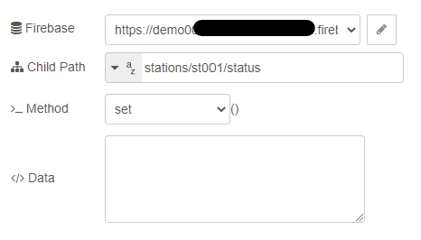
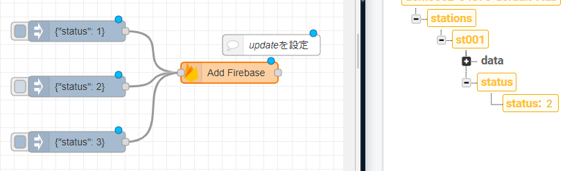
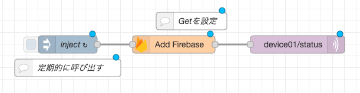
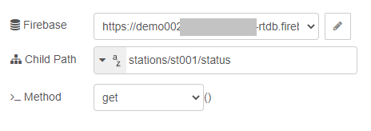
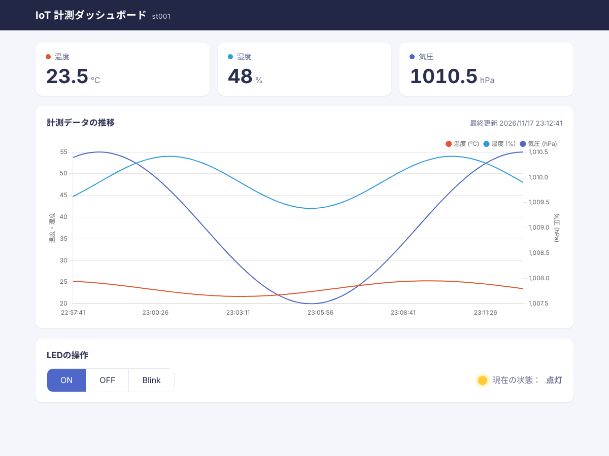

# IoTシステムの構築とその活用

> **完成版のNode-REDフロー：** この演習が終わった時点のフローを [`node-red/s07_firebase_led.json`](node-red/s07_firebase_led.json) に用意しています．遅れたときや，うまく動かないときに読み込んで使ってください（読み込み方は [node-red/README.md](node-red/README.md)）．


# Firebaseとの連携

前回は，MQTT Subscriber を利用して，ESP32のLEDの状態を変更することができました．では，FirebaseのRealtime databaseと連携してESP32のLEDの状態を変更していきます．


## `Realtime database`へLEDの状態を保存する．

BME280データと同様に，`Add Firebase`を利用していきます．

BME280データの保存先は，`stations/st001/data`でした．LEDの状態の保存先は， `stations/st001/status` とします． BME280の時は，新規にデータを追加していたので，`push`メソッドを使っていましたが，今回は，そのパス上のデータ更新ですので，`set`メソッドを使います．

これまでに作成したフローを活用していきます．
MQTT Subscribe用に作成したフローの `inject`ノードと `mqtt out` を切り離します．
 `Add Firebase` ノードを追加し，切り離した`inject`ノードと接続します．


 
 追加した`Add Firebase`の設定を開き，
 - `Firebase`項目は，前回設定した，firebase Realtimeの設定を選択します．
 - `Child Path` は，`stations/st001/status`を入力します．このパスに，デバイスのLEDのカラー状態を設定します．
 - `_Method`は，`set`を選択します．
 



それぞれの `inject` ノードを操作することで，Realtime Database内の状態を変更することができます．



図は，Node-RED内の 2つめの`inject`ノードを操作したさいに，Realtime Database内のデータが更新されている様子です．


## `Realtime database`内のデータを取得して，MQTTで通知する

Realtime Database内のパス`stations/st001/status` のデータを取得して，MQTTでサブスクライバーへ通知していきます．
取得でも，`Add Firebase`ノードを利用します．しかし，このノードは，Realtime Databaseの変更監視(`.on`イベント)をすることはできません．`inject`ノードの定期実行機能を利用していきます．

新たに，`Add Firebase` ノードを追加します．図の様に，ノードを配置接続していきます．`mqtt out` ノードは前節で切り離したものです．


 
 追加した`Add Firebase`の設定を開き，
 - `Firebase`項目は，前回設定した，firebase Realtimeの設定を選択します．
 - `Child Path` は，`stations/st001/status`を入力します．このパスに，デバイスのLEDのカラー状態を設定します
 - `_Method`は，`get`を選択します．
 




Realtime Databaseに設定したLEDの状態に応じてデバイスのLEDを変更することが可能となりました．


## WebアプリケーションからLEDを操作する

WebアプリケーションからRealtime Databaseを操作して，LEDの状態を変更していきます．Webページ内にボタンを設置し，ボタンを押すことでLEDの状態を更新するようにします．

ボタンをHTML内に作成し，ボタンがクリックされたときにRealtime Database内のデータを更新していきます．

Firebase CLIを起動します．Firebase CLI内で，プロジェクトディレクトリに移動します．

Firebase プロジェクトの `public` フォルダ内の `index.html` の内容を以下の通りに修正します．（資料として `web/public/index_02.html` が該当します．）

```html
<!DOCTYPE html>
<html lang="ja">
  <head>
    <meta charset="utf-8">
    <meta name="viewport" content="width=device-width, initial-scale=1">
    <title>データの可視化</title>

    <!-- vis.js（グラフ表示ライブラリ） -->
    <script src="https://cdnjs.cloudflare.com/ajax/libs/vis/4.21.0/vis.min.js"></script>
    <link rel="stylesheet" type="text/css" href="https://cdnjs.cloudflare.com/ajax/libs/vis/4.21.0/vis.min.css" />

    <style type="text/css">
        .style-0 {
            fill: #f2ea00;
            fill-opacity: 0;
            stroke-width: 2px;
            stroke: #003cb3;
        }
        .style-1 {
            fill: #00b72b;
            fill-opacity: 0;
            stroke-width: 2px;
            stroke: #00b72b;
        }
        .style-2 {
            fill: #b70089;
            fill-opacity: 0;
            stroke-width: 2px;
            stroke: #b70089;
        }
    </style>
  </head>
  <body>

  <h2>計測データ</h2>
  <div id="visualization"></div>
  <div id="buttons">
    <button id="btn-on">ON</button>
    <button id="btn-off">OFF</button>
    <button id="btn-blink">Blink</button>
  </div>

  <script type="module">
    // Firebase SDK（modular版）をCDNから読み込む
    import { initializeApp } from "https://www.gstatic.com/firebasejs/13.3.0/firebase-app.js";
    import { getDatabase, ref, query, limitToLast, onChildAdded, set } from "https://www.gstatic.com/firebasejs/13.3.0/firebase-database.js";

    const station_id = "st001";

    // Firebase Hostingが提供するプロジェクトの設定を読み込んで初期化する
    const response = await fetch("/__/firebase/init.json");
    const firebaseConfig = await response.json();
    const app = initializeApp(firebaseConfig);
    const db = getDatabase(app);

    // ---------- グラフ表示 ----------

    let graph2d = null;
    let dataset = null;

    function createGraph() {
      let container = document.getElementById("visualization");
      let names = ["Humidity", "Pressure", "Temperature"];
      dataset = new vis.DataSet();
      let groups = new vis.DataSet();
      groups.add({
          id: 0,
          content: names[0],
          className: "style-0",
          options: {
            yAxisOrientation: "left",
            interpolation: false,
            drawPoints: {
                size: 2
            }
          }
      });
      groups.add({
          id: 1,
          content: names[1],
          className: "style-1",
          options: {
            yAxisOrientation: "right",
            interpolation: false,
            drawPoints: {
              size: 2
            }
          }
      });
      groups.add({
          id: 2,
          content: names[2],
          className: "style-2",
          options: {
            yAxisOrientation: "left",
            interpolation: false,
            drawPoints: {
              size: 2
            }
          }
      });
      let date = new Date();
      let options = {
          dataAxis: {
              showMinorLabels: true,
              alignZeros: false
          },
          width: "100%",
          height: "550px",
          legend: { left: { position: "top-left" },
                    right: { position: "top-right" } },
          start: date.setMinutes(date.getMinutes() - 5),
          end: date.setMinutes(date.getMinutes() + 15)
      };
      graph2d = new vis.Graph2d(container, dataset, groups, options);
    }

    // データの監視を開始する
    function startGraph() {
      createGraph();
      const dataRef = query(ref(db, "stations/" + station_id + "/data"), limitToLast(100));
      // データが追加されるたびに呼ばれる（最初は既存の最新100件について呼ばれる）
      onChildAdded(dataRef, (snapshot) => {
          const newData = snapshot.val();
          addItem(newData.timestamp, newData.humid, 0);
          addItem(newData.timestamp, newData.press, 1);
          addItem(newData.timestamp, newData.temp, 2);
          let now = new Date();
          graph2d.setWindow(now.setMinutes(now.getMinutes() - 5), now.setMinutes(now.getMinutes() + 10), {animation: false});
      });
    }

    function addItem(timestamp, value, g) {
      dataset.add({ x: new Date(timestamp), y: value, group: g });
    }


    // ---------- LEDの操作 ----------

    function changeStatus(st) {
      set(ref(db, "stations/" + station_id + "/status"), { status: st });
    }

    // type="module" の中で定義した関数は onclick="..." から呼べないため，
    // addEventListener でボタンと関数を結び付ける
    document.getElementById("btn-on").addEventListener("click", () => changeStatus(1));
    document.getElementById("btn-off").addEventListener("click", () => changeStatus(2));
    document.getElementById("btn-blink").addEventListener("click", () => changeStatus(3));

    // グラフの表示を開始する
    startGraph();
  </script>

  </body>
</html>
```


これまでのindex.htmlとの違いは，ボタンを追加していること，ボタンをクリックしたときにデータを書き込む処理を追加している点です．

```html
  <div id="buttons">
    <button id="btn-on">ON</button>
    <button id="btn-off">OFF</button>
    <button id="btn-blink">Blink</button>
  </div>
```

```javascript
    import { getDatabase, ref, query, limitToLast, onChildAdded, set } from "https://www.gstatic.com/firebasejs/13.3.0/firebase-database.js";

    // ...

    function changeStatus(st) {
      set(ref(db, "stations/" + station_id + "/status"), { status: st });
    }

    document.getElementById("btn-on").addEventListener("click", () => changeStatus(1));
    document.getElementById("btn-off").addEventListener("click", () => changeStatus(2));
    document.getElementById("btn-blink").addEventListener("click", () => changeStatus(3));
```

- `set()` は，指定した場所のデータを丸ごと書き換えます．Node-REDの `Add Firebase` ノードの `set` メソッドと同じ働きです．
- `<script type="module">` の中で定義した関数は，ページ全体からは見えません．そのため，`<button onclick="changeStatus(1)">` のようにHTMLに直接書くと「関数が見つからない」というエラーになります．代わりに `addEventListener()` でボタンと関数を結び付けます．
- 新しく使う `set` を，`import` の一覧に追加するのを忘れないようにします．

Firebase CLIツールで，以下のコマンドを入力します．

```bash
firebase deploy
```

CLIツールで最後に表示される，`Hosting URL` のアドレスをブラウザに入力し確認をします．




ボタンをクリックすることで，Realtime Database内の状態が更新され，それに伴い，ESP32のLEDの状態が変更されるのが確認できます．


# リファレンス

- Firebase Documents
  - https://firebase.google.com/docs/
  - ウェブでのデータの読み取りと書き込み
    - https://firebase.google.com/docs/database/web/read-and-write?hl=ja


