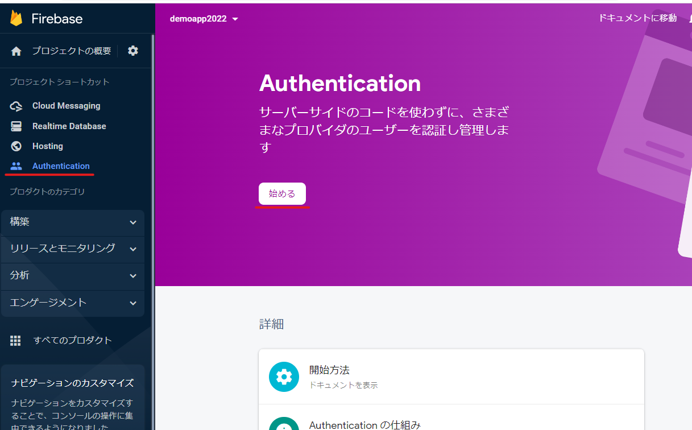
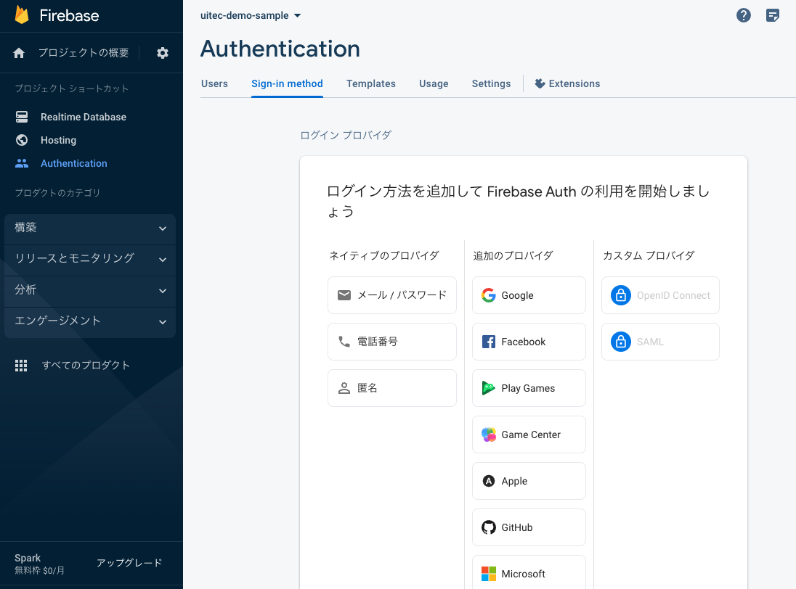
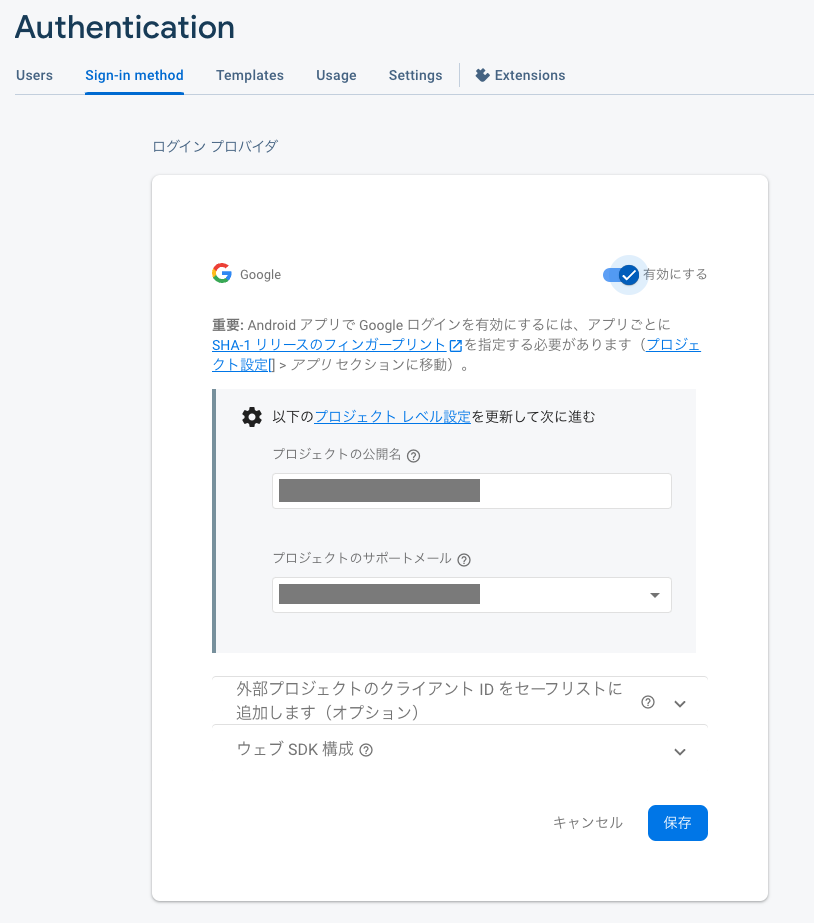
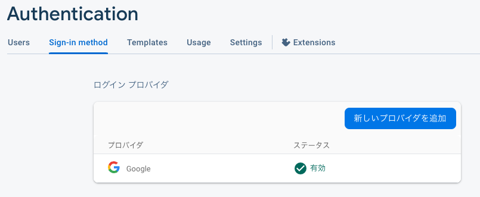
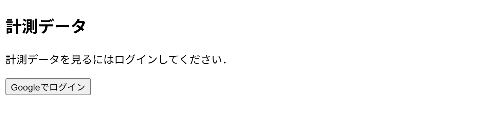

# IoTシステムの構築とその活用


# Webアプリケーションにログイン機能の追加

演習では，Firebaseの認証機能である，Firebase Authenticationを利用します．ログインの方法（プロバイダ）として，Googleアカウントを使います．

> 以前の資料では，ログイン画面を自動で作るライブラリ「FirebaseUI」を使っていました．FirebaseUIは古い書き方（compat版）のSDKにしか対応していないため，本資料ではFirebase Authenticationの機能を直接使ってログイン処理を作ります．コードは少し増えますが，ログインの仕組みがコードから読み取れるようになります．

## 認証の流れ


計測ページにて，計測データを閲覧するためにはログインが必要と仕様変更します．流れは以下の通りです．

- ページへアクセス
- 認証されていない場合，「Googleでログイン」ボタンを表示
- ボタンを押すと，Googleアカウントを選ぶポップアップが開く
- 認証されている場合，計測データとLEDの操作ボタンを表示

これまでは，ページへアクセスしたら直接データを表示していました．データ取得・グラフ表示処理を行う前にログイン処理の機能を追加していきます．


## Firebase Consoleで認証機能を有効にする

### 左側のメニューより，Authenticationを選択し，「始める」をクリックします

<center>

</center>


### ログインプロバイダを選択します．今回は「Google」を選択します．

<center>

</center>

### 「Google」を有効にします．

<center>

</center>

<center>

</center>


## ログインは `firebaseapp.com` のアドレスで行う

Firebase Hostingのページは，`https://[プロジェクトID].web.app` と `https://[プロジェクトID].firebaseapp.com` の2つのアドレスで開けます．**ログイン機能を使うページは，`firebaseapp.com` の方で開いてください．**

Googleでログインする処理は，`[プロジェクトID].firebaseapp.com` のドメインで行われます（Firebaseの設定の `authDomain`）．ページを `web.app` のアドレスで開くと，ページとログイン処理のドメインが異なるため，ブラウザから見ると「別のサイトのデータ」をやり取りすることになります．最近のブラウザ（Chrome，Safari，Firefoxなど）は，プライバシー保護のためにこうした別サイトのデータのやり取りを制限しています．そのため，**アカウントを選んだ直後にポップアップが閉じて，ログインできない**ことがあります．

ページとログイン処理のドメインをそろえれば，この問題は起きません．作成するページでは，`web.app` などの別のアドレスで開いたときに，`firebaseapp.com` のアドレスへのリンクを表示するようにしています．

> `web.app` のアドレスや独自ドメインでログインさせたい場合は，この節の最後の「発展」を参照してください．

## ログイン機能の実装

`public` フォルダ内の `index.html` の内容を以下の通りに修正します．（資料として `web/public/index_03.html` が該当します．）

```html
<!DOCTYPE html>
<html lang="ja">
  <head>
    <meta charset="utf-8">
    <meta name="viewport" content="width=device-width, initial-scale=1">
    <title>データの可視化</title>

    <!-- vis.js（グラフ表示ライブラリ） -->
    <script src="https://cdnjs.cloudflare.com/ajax/libs/vis/4.21.0/vis.min.js"></script>
    <link rel="stylesheet" type="text/css" href="https://cdnjs.cloudflare.com/ajax/libs/vis/4.21.0/vis.min.css" />

    <style type="text/css">
        .style-0 {
            fill: #f2ea00;
            fill-opacity: 0;
            stroke-width: 2px;
            stroke: #003cb3;
        }
        .style-1 {
            fill: #00b72b;
            fill-opacity: 0;
            stroke-width: 2px;
            stroke: #00b72b;
        }
        .style-2 {
            fill: #b70089;
            fill-opacity: 0;
            stroke-width: 2px;
            stroke: #b70089;
        }
        .message {
            color: #c00;
        }
    </style>
  </head>
  <body>

  <h2>計測データ</h2>

  <!-- 未ログインのときに表示する部分 -->
  <div id="login-area" style="display: none;">
    <p>計測データを見るにはログインしてください．</p>
    <button id="btn-login">Googleでログイン</button>
    <p id="domain-notice" class="message" style="display: none;"></p>
    <p id="login-message" class="message"></p>
  </div>

  <!-- ログイン済みのときに表示する部分 -->
  <div id="main-area" style="display: none;">
    <div>
      <span id="user-name"></span> でログイン中
      <button id="btn-logout" style="float: right;">ログアウト</button>
    </div>
    <div id="visualization"></div>
    <div id="buttons">
      <button id="btn-on">ON</button>
      <button id="btn-off">OFF</button>
      <button id="btn-blink">Blink</button>
    </div>
    <p id="data-message" class="message"></p>
  </div>

  <script type="module">
    // Firebase SDK（modular版）をCDNから読み込む
    import { initializeApp } from "https://www.gstatic.com/firebasejs/13.3.0/firebase-app.js";
    import { getDatabase, ref, query, limitToLast, onChildAdded, set } from "https://www.gstatic.com/firebasejs/13.3.0/firebase-database.js";
    import { getAuth, GoogleAuthProvider, signInWithPopup, signOut, onAuthStateChanged } from "https://www.gstatic.com/firebasejs/13.3.0/firebase-auth.js";

    const station_id = "st001";

    // Firebase Hostingが提供するプロジェクトの設定を読み込んで初期化する
    const response = await fetch("/__/firebase/init.json");
    const firebaseConfig = await response.json();
    const app = initializeApp(firebaseConfig);
    const db = getDatabase(app);
    const auth = getAuth(app);
    const provider = new GoogleAuthProvider();

    // ログイン用ドメイン（authDomain）と違うアドレスで開いている場合は案内を表示する
    // 例: https://[プロジェクトID].web.app で開くと，ブラウザによってはログインできない
    const isLocal = ["localhost", "127.0.0.1"].includes(location.hostname);
    if (!isLocal && location.hostname !== firebaseConfig.authDomain) {
      const url = "https://" + firebaseConfig.authDomain + location.pathname;
      const notice = document.getElementById("domain-notice");
      notice.innerHTML = 'ログインできない場合は，<a href="' + url + '">' + url + '</a> を開いてください．';
      notice.style.display = "block";
    }


    // ---------- 認証 ----------

    // ログイン状態が変わるたびに呼ばれる（ページを開いたときにも1回呼ばれる）
    onAuthStateChanged(auth, (user) => {
      if (user) {
        // ログイン済み
        document.getElementById("login-area").style.display = "none";
        document.getElementById("main-area").style.display = "block";
        document.getElementById("user-name").textContent = user.displayName || user.email;
        startGraph();
      } else {
        // 未ログイン
        stopGraph();
        document.getElementById("login-area").style.display = "block";
        document.getElementById("main-area").style.display = "none";
      }
    });

    // ログインボタン：Googleアカウントでログインするポップアップを開く
    document.getElementById("btn-login").addEventListener("click", async () => {
      const message = document.getElementById("login-message");
      message.textContent = "";
      try {
        await signInWithPopup(auth, provider);
        // 成功すると onAuthStateChanged が呼ばれて画面が切り替わる
      } catch (error) {
        console.error(error);
        message.textContent = loginErrorMessage(error);
      }
    });

    // ログアウトボタン
    document.getElementById("btn-logout").addEventListener("click", () => {
      signOut(auth);
    });

    // ログイン失敗時のメッセージ
    function loginErrorMessage(error) {
      switch (error.code) {
        case "auth/popup-blocked":
          return "ポップアップがブロックされました．ブラウザの設定でポップアップを許可してください．";
        case "auth/popup-closed-by-user":
        case "auth/cancelled-popup-request":
          return "ログインが完了しませんでした．もう一度お試しください．";
        case "auth/unauthorized-domain":
          return "このドメインはログインが許可されていません．Firebaseコンソールの Authentication → 設定 → 承認済みドメイン を確認してください．";
        case "auth/operation-not-allowed":
          return "Googleログインが有効になっていません．Firebaseコンソールの Authentication → ログイン方法 を確認してください．";
        default:
          return "ログインに失敗しました（" + error.code + "）";
      }
    }


    // ---------- グラフ表示 ----------

    let graph2d = null;
    let dataset = null;
    let unsubscribe = null;   // データの監視を止めるための関数

    function createGraph() {
      let container = document.getElementById("visualization");
      let names = ["Humidity", "Pressure", "Temperature"];
      dataset = new vis.DataSet();
      let groups = new vis.DataSet();
      groups.add({
          id: 0,
          content: names[0],
          className: "style-0",
          options: {
            yAxisOrientation: "left",
            interpolation: false,
            drawPoints: {
                size: 2
            }
          }
      });
      groups.add({
          id: 1,
          content: names[1],
          className: "style-1",
          options: {
            yAxisOrientation: "right",
            interpolation: false,
            drawPoints: {
              size: 2
            }
          }
      });
      groups.add({
          id: 2,
          content: names[2],
          className: "style-2",
          options: {
            yAxisOrientation: "left",
            interpolation: false,
            drawPoints: {
              size: 2
            }
          }
      });
      let date = new Date();
      let options = {
          dataAxis: {
              showMinorLabels: true,
              alignZeros: false
          },
          width: "100%",
          height: "550px",
          legend: { left: { position: "top-left" },
                    right: { position: "top-right" } },
          start: date.setMinutes(date.getMinutes() - 5),
          end: date.setMinutes(date.getMinutes() + 15)
      };
      graph2d = new vis.Graph2d(container, dataset, groups, options);
    }

    // データの監視を開始する
    function startGraph() {
      if (graph2d === null) {
        createGraph();
      }
      if (unsubscribe !== null) {
        return;   // すでに監視中
      }
      const dataRef = query(ref(db, "stations/" + station_id + "/data"), limitToLast(100));
      // データが追加されるたびに呼ばれる（最初は既存の最新100件について呼ばれる）
      unsubscribe = onChildAdded(dataRef, (snapshot) => {
          const newData = snapshot.val();
          addItem(newData.timestamp, newData.humid, 0);
          addItem(newData.timestamp, newData.press, 1);
          addItem(newData.timestamp, newData.temp, 2);
          let now = new Date();
          graph2d.setWindow(now.setMinutes(now.getMinutes() - 5), now.setMinutes(now.getMinutes() + 10), {animation: false});
      }, (error) => {
          // セキュリティルールで読み取りが許可されていない場合など
          console.error(error);
          document.getElementById("data-message").textContent = "データを読み込めません（" + error.message + "）";
      });
    }

    // データの監視を止めて，グラフを空にする
    function stopGraph() {
      if (unsubscribe !== null) {
        unsubscribe();
        unsubscribe = null;
      }
      if (dataset !== null) {
        dataset.clear();
      }
    }

    function addItem(timestamp, value, g) {
      dataset.add({ x: new Date(timestamp), y: value, group: g });
    }


    // ---------- LEDの操作 ----------

    function changeStatus(st) {
      set(ref(db, "stations/" + station_id + "/status"), { status: st })
        .catch((error) => {
          console.error(error);
          document.getElementById("data-message").textContent = "LEDの状態を変更できません（" + error.message + "）";
        });
    }

    // type="module" の中で定義した関数は onclick="..." から呼べないため，
    // addEventListener でボタンと関数を結び付ける
    document.getElementById("btn-on").addEventListener("click", () => changeStatus(1));
    document.getElementById("btn-off").addEventListener("click", () => changeStatus(2));
    document.getElementById("btn-blink").addEventListener("click", () => changeStatus(3));
  </script>

  </body>
</html>
```

### 画面の構成

ページには，未ログインのときに表示する部分（`login-area`）と，ログイン済みのときに表示する部分（`main-area`）を用意し，ログイン状態に応じてどちらかを表示します．

```html
  <!-- 未ログインのときに表示する部分 -->
  <div id="login-area" style="display: none;">
    ...
    <button id="btn-login">Googleでログイン</button>
    ...
  </div>

  <!-- ログイン済みのときに表示する部分 -->
  <div id="main-area" style="display: none;">
    ...
  </div>
```

### 認証機能の読み込み

`firebase-auth.js` から，使う機能を `import` します．

```javascript
import { getAuth, GoogleAuthProvider, signInWithPopup, signOut, onAuthStateChanged } from "https://www.gstatic.com/firebasejs/13.3.0/firebase-auth.js";

const auth = getAuth(app);
const provider = new GoogleAuthProvider();
```

### ログイン状態の監視

`onAuthStateChanged()` は，ログイン状態が変わるたびに呼ばれる関数を登録します．ページを開いたときにも1回呼ばれるので，「前回ログインしたままの状態」もここで判定できます．

```javascript
onAuthStateChanged(auth, (user) => {
  if (user) {
    // ログイン済み：計測データを表示して，データの監視を始める
    ...
    startGraph();
  } else {
    // 未ログイン：データの監視を止めて，ログインボタンを表示
    stopGraph();
    ...
  }
});
```

画面の切り替えは，ログインボタンやログアウトボタンの処理の中ではなく，**この関数の中だけで行う**のがポイントです．ログイン・ログアウトの方法が増えても，画面の切り替えの処理は1か所で済みます．

### ログインとログアウト

ログインボタンを押すと，`signInWithPopup()` でGoogleアカウントを選ぶポップアップを開きます．ログインに成功すると，`onAuthStateChanged()` に登録した関数が呼ばれて画面が切り替わります．

```javascript
document.getElementById("btn-login").addEventListener("click", async () => {
  try {
    await signInWithPopup(auth, provider);
  } catch (error) {
    // ポップアップがブロックされた，途中で閉じた，などの場合
    message.textContent = loginErrorMessage(error);
  }
});

document.getElementById("btn-logout").addEventListener("click", () => {
  signOut(auth);
});
```

ログインに失敗したときは，`error.code` の値（例：`auth/popup-blocked`）に応じて，原因と対処を表示します．

### データの監視の開始と停止

`onChildAdded()` は，監視を止めるための関数を返します．ログアウトしたときにはこの関数を呼んで監視を止め，グラフを空にします．再びログインしたときは，監視を始め直します．

```javascript
unsubscribe = onChildAdded(dataRef, (snapshot) => { ... }, (error) => {
  // 読み取りが許可されていない場合など
});

// ログアウト時
unsubscribe();
```

`onChildAdded()` の3つ目の引数には，データを読めなかったときに呼ばれる関数を指定しています．次の節でセキュリティルールを設定した後，ログインしていない状態でデータを読もうとすると，この関数が呼ばれます．

## デプロイして確認

```bash
firebase deploy
```

ブラウザで `https://[プロジェクトID].firebaseapp.com` を開くと，次の状態になっています．

<center>

</center>

`Googleでログイン` ボタンを押し，Googleアカウントを選ぶと，計測データのグラフとLEDの操作ボタンが表示されます．ページを再読み込みしても，ログインした状態が保たれます．`ログアウト` ボタンを押すと，最初の画面に戻ります．

> ログインできないときは，[つまずき対応集](troubleshooting.md) の「Firebase」の項目を参照してください．

## 発展：`web.app` のアドレスや独自ドメインでログインさせる

`web.app` のアドレス（または独自ドメイン）でログインさせるには，ログイン処理のドメイン（`authDomain`）を，ページを開いているドメインに合わせます．Firebase Hostingは，公開しているどのドメインでもログイン処理用のページ（`/__/auth/handler`）を用意しているので，これが可能です．

1. `index.html` で，設定を読み込んだ直後に `authDomain` を書き換えます．
   ```javascript
   const firebaseConfig = await response.json();
   firebaseConfig.authDomain = location.hostname;   // ページを開いているドメインに合わせる
   const app = initializeApp(firebaseConfig);
   ```
2. Google Cloud コンソール（https://console.cloud.google.com）で，Firebaseと同じプロジェクトを選び，`APIとサービス` → `認証情報` を開きます．
3. `OAuth 2.0 クライアント ID` の一覧から `Web client (auto created by Google Service)` を開き，`承認済みのリダイレクト URI` に次のアドレスを追加して保存します．
   ```
   https://[プロジェクトID].web.app/__/auth/handler
   ```
4. 独自ドメインの場合は，そのドメインをFirebaseコンソールの `Authentication` → `設定` → `承認済みドメイン` にも追加します．
5. `firebase deploy` で公開し直します．

この設定をしないままアドレスだけを変えると，Googleのログイン画面で `redirect_uri_mismatch` というエラーになります．

## リファレンス

- JavaScript で Google ログインを使用して認証する
  - https://firebase.google.com/docs/auth/web/google-signin?hl=ja
- サードパーティのストレージへのアクセスをブロックするブラウザで signInWithRedirect を使用する際のベスト プラクティス
  - https://firebase.google.com/docs/auth/web/redirect-best-practices?hl=ja

> **注意：** この節で追加したのは「ログインしないとグラフを表示しない」というWebページ側の仕組みだけです．データベース自体は，まだ誰でも読み書きできる状態です．次の節（[s09 データベースのセキュリティルール](s09.md)）で，データベース側の制限を設定します．
